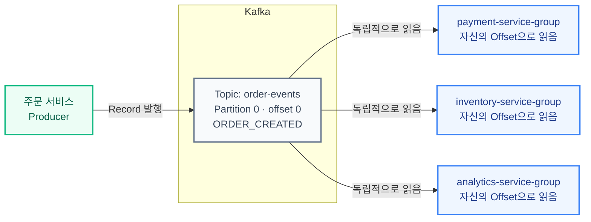
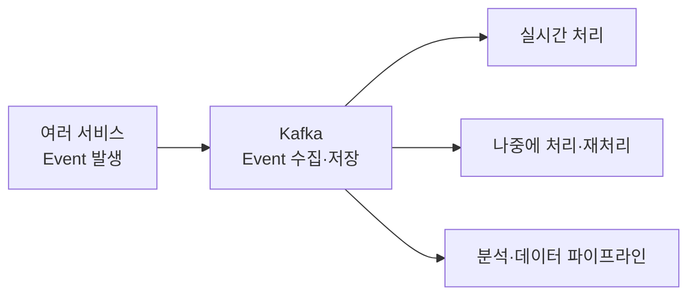
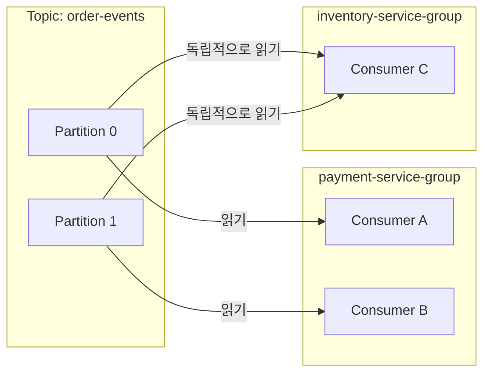
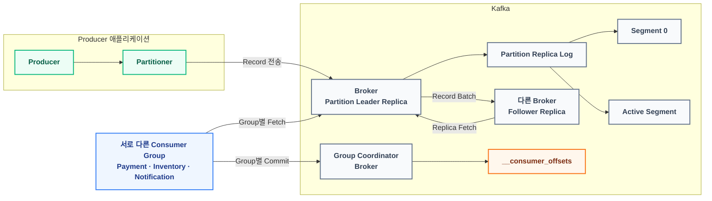

# Apache Kafka 핵심 기본 개념 정리

Kafka를 처음 공부할 때는 용어를 하나씩 외우기보다, 각 개념이 어떤 역할을 맡고 서로 어떻게 연결되는지를 먼저 잡는 것이 좋습니다.

이 문서는 Kafka의 기본 구조를 `정의`, `관계`, `흐름` 중심으로 정리합니다.

전체 문서의 읽기 순서는 [Kafka 학습 가이드](KAFKA_STUDY_GUIDE.md)에서 확인할 수 있습니다. 이 문서는 입문용 중심 문서이며, Broker·KRaft·전송 보장의 상세 내용은 주제별 문서로 분리했습니다.

---

## 1. Kafka 기본 이해

Kafka가 왜 필요한지, 어떤 종류의 데이터를 다루는지 먼저 잡습니다.

### 1. 카프카 (Kafka)

* **정의**: 계속 발생하는 이벤트 스트림을 저장하고, 여러 시스템이 각자의 속도로 읽고 처리할 수 있게 해주는 분산 이벤트 스트리밍 플랫폼입니다.
* **본질**: Event를 Partition Log에 일정 기간 보관하고, 여러 Consumer Group이 각자의 Offset으로 읽게 해주는 데이터 인프라입니다.
* **관계**: Producer가 Event를 Kafka에 보내면, Kafka는 그 Event를 Topic 안의 Partition Log에 Record로 저장합니다. Consumer Group은 Offset을 기준으로 필요한 Record를 읽습니다.

**Kafka가 필요한 이유**

서비스가 작을 때는 하나의 서비스가 필요한 시스템을 직접 호출할 수 있습니다. 하지만 같은 Event를 필요로 하는 시스템이 늘어나면 생산자가 모든 소비자를 알아야 하고, 느리거나 장애가 발생한 소비자가 생산자의 처리 흐름에도 영향을 줄 수 있습니다.

| 직접 호출 | Kafka를 통한 Event 전달 |
|---|---|
| 생산자가 호출할 소비자를 알아야 함 | 생산자는 Topic만 알면 됨 |
| 소비자의 지연과 장애가 생산자에게 전파될 수 있음 | Kafka가 Record를 보관해 처리 시점을 분리 |
| 지나간 요청을 다시 처리하기 어려움 | 보관 중인 Record를 다시 읽을 수 있음 |
| 소비자가 늘면 생산자의 호출 로직도 늘어남 | 새 Consumer Group이 같은 Topic을 독립적으로 읽음 |

Kafka를 사용하면 생산자는 Consumer의 처리가 끝날 때까지 기다리는 대신 Event를 Kafka에 저장합니다. Consumer들은 저장된 Record를 각자의 속도로 가져가 처리합니다.



**전통적인 작업 큐와의 차이**

Kafka도 메시지 큐처럼 사용할 수 있습니다. 다만 전통적인 작업 큐가 `메시지를 누가 처리할 것인가`에 초점을 둔다면, Kafka는 `저장된 Event Log를 각 Consumer Group이 어디까지 읽었는가`에 초점을 둡니다.

| 구분 | 전통적인 작업 큐 | Kafka |
|---|---|---|
| 소비 방식 | 같은 Queue의 Consumer들이 메시지를 나누어 처리 | 서로 다른 Consumer Group이 같은 Record를 각각 읽을 수 있음 |
| 데이터 수명 | 처리 후 메시지를 제거하는 방식으로 많이 사용 | 읽어도 Record를 일정 기간 유지 |
| 재처리 | 제품과 구성에 따라 다름 | 보관 중인 Record를 다시 읽을 수 있음 |

즉 Kafka에서 Record를 `소비한다`는 것은 Record를 읽고 처리하는 것이지, Record 자체를 없앤다는 뜻이 아닙니다. 구체적인 읽기 위치와 삭제 방식은 뒤의 Offset Commit과 Retention에서 다룹니다.

다른 메시징 제품도 영속 저장, 독립적인 Subscription, 재처리를 지원할 수 있으므로 이 비교가 모든 메시지 큐에 절대적으로 적용되는 것은 아닙니다.

**트래픽과 속도**

Kafka는 트래픽이나 처리해야 할 일을 없애지 않습니다. Record를 중간에 보관해 Producer와 Consumer가 같은 속도로 움직이지 않아도 되게 만드는 것이 핵심입니다.

또한 개별 요청을 무조건 빠르게 만드는 기술도 아닙니다. Kafka는 대량의 Event를 안정적으로 받아두고, 여러 Consumer가 각자의 속도로 처리할 수 있게 하는 데 강점이 있습니다.

Kafka는 같은 Event를 여러 시스템이 읽어야 하거나, Event를 보관하고 재처리해야 하거나, 대량 처리량을 확장해야 할 때 특히 유용합니다. 반대로 소비자 하나가 간단한 비동기 작업을 처리하는 정도라면 일반적인 작업 큐가 더 단순할 수 있습니다.

### 2. 이벤트와 커맨드 (Event & Command)

Event와 Command는 메시지의 의도가 다릅니다.

* **Event**: 시스템에서 이미 발생한 사실을 나타냅니다. 예: `PAYMENT_COMPLETED`
* **Command**: 특정 대상에게 어떤 행동을 하라고 요청합니다. 예: `PROCESS_PAYMENT`

```text
Command: 결제를 처리해라
          ↓ 행동 요청
         결제 서비스
          ↓ 발생한 사실
Event:   결제가 완료되었다
```

Kafka에서는 Event를 주로 다루지만 Command도 Record로 만들어 전달할 수 있습니다. 다만 Command는 처리 대상과 책임이 명확해야 하므로 Topic과 Consumer를 더 신중하게 설계해야 합니다.

### 3. 이벤트 스트리밍 (Event Streaming)

Event Streaming은 서비스에서 계속 발생하는 Event를 실시간으로 수집하고, 저장하고, 필요한 시스템이 처리할 수 있게 하는 방식입니다.



Kafka는 Event를 한 번 전달하고 끝내는 것이 아니라, Event의 흐름을 Partition Log에 저장합니다. Consumer는 실시간으로 읽을 수도 있고, 보관 기간 안에서 나중에 읽거나 다시 처리할 수도 있습니다.

---

## 2. Kafka에 저장되는 데이터 구조

Kafka에 들어온 Event가 내부에서 어떤 단위로 저장되는지 정리합니다.

### 4. 레코드 (Record)

* **정의**: Kafka에 저장되고 전달되는 데이터 한 건입니다.
* **관계**: Producer가 보낸 Event나 Command는 Kafka 내부에서 Record 형태로 Partition Log에 저장됩니다.
* **표현**: Event와 Command는 데이터의 의미를 나타내고, Record는 Kafka에서 이를 저장하고 전달하는 단위를 나타냅니다. Message는 Record와 비슷한 뜻으로 쓰이기도 합니다.

Kafka에 저장된 Record는 다음과 같은 정보와 연결됩니다.

```text
Topic: order-events / Partition 1
└── offset 42: Broker에 저장된 Record
    ├── Key       : byte[] 또는 null
    ├── Value     : byte[] 또는 null
    ├── Headers   : 문자열 Key + byte[] Value
    └── Timestamp : 시간 정보
```

여기서 Topic과 Partition은 Record가 속한 저장 위치이고, Offset은 Broker가 Partition에 Record를 추가하면서 부여하는 위치 번호입니다.

Record는 처리 단계에 따라 다음과 같이 구분하면 이해하기 쉽습니다.

| 단계 | 표현 | 주요 정보 |
|---|---|---|
| Producer에서 전송 준비 | `ProducerRecord` | Topic, 선택적 Partition과 Timestamp, Key, Value, Headers |
| Broker의 Partition Log에 저장 | 저장된 Record | 직렬화된 Key와 Value, Headers, Timestamp, Broker가 부여한 Offset |
| Consumer가 읽은 결과 | `ConsumerRecord` | Topic, Partition, Offset, 역직렬화된 Key와 Value, Headers, Timestamp |

`ProducerRecord`는 Producer Client가 전송에 사용하는 객체이고, `ConsumerRecord`는 Consumer Client가 읽은 결과를 전달하는 객체입니다. 둘 다 Kafka Broker의 디스크에 객체째로 저장되는 것은 아닙니다.

Kafka Broker는 Key와 Value의 의미나 데이터 형식을 해석하지 않고 바이트로 저장합니다. Headers의 Value도 바이트입니다. 객체가 바이트로 변환되는 과정은 Producer 절에서 이어서 다룹니다.

Producer가 목적지 Topic을 지정하고, Partition을 직접 지정하지 않았다면 Producer Client가 Partition을 선택합니다. Broker는 선택된 Partition에 Record를 저장하고 Offset을 부여합니다.

처음에는 이렇게 이해하면 됩니다.

```text
Event          = 이미 발생한 사실
Command        = 특정 행동을 요청하는 메시지
ProducerRecord = Producer가 Kafka로 보낼 내용을 담은 객체
저장된 Record   = Partition Log에 저장된 데이터 한 건
ConsumerRecord = Consumer가 위치 정보와 함께 받은 데이터 한 건
Message        = Record와 비슷한 뜻으로 쓰이는 표현
```

### 5. 토픽 (Topic)

* **정의**: 관련된 Record의 흐름을 분류하고 발행·구독하기 위한 논리적인 이름입니다.
* **비유**: 데이터베이스의 테이블, 이메일의 편지함처럼 특정 성격의 데이터가 모이는 논리적 분류입니다.
* **관계**: Producer는 Topic에 Record를 쓰고, Consumer는 Topic을 구독해서 Record를 읽습니다.

```text
Topic: order-events
├── ORDER_CREATED
├── ORDER_PAID
└── ORDER_CANCELLED
```

하나의 Topic이 반드시 한 가지 Event Type만 담아야 하는 것은 아닙니다. 예를 들어 `order-events`에는 주문 생명주기와 관련된 여러 종류의 Event가 함께 들어갈 수 있습니다.

Topic은 실제 파일 하나가 아닙니다.

Topic은 논리적인 이름이고, 실제 저장은 Topic 안의 Partition에서 일어납니다.

```text
Topic: order-events
├── Partition 0
├── Partition 1
└── Partition 2
```

### 6. 파티션 (Partition)

* **정의**: Topic을 여러 개의 순서 있는 로그로 나눈 단위입니다.
* **비유**: 하나의 Topic 안에 여러 차선이 있는 구조로 생각할 수 있습니다.
* **관계**: Record는 Topic에 바로 저장되는 것이 아니라, Topic 안의 특정 Partition에 저장됩니다.

```text
Topic: order-events
└── Partition 0
      ├── offset 0: ORDER_CREATED
      ├── offset 1: ORDER_PAID
      └── offset 2: ORDER_CANCELLED
```

Topic을 Partition으로 나누는 이유는 크게 두 가지입니다.

* 여러 Broker에 데이터를 분산 저장하기 위해
* Producer와 Consumer가 병렬로 처리할 수 있게 하기 위해

Kafka에서 이벤트의 순서는 Topic 전체가 아니라 Partition 내부에서만 보장됩니다.

### 7. 로그 (Log)

* **정의**: Record가 Partition 안에 순서대로 추가되는 저장 구조입니다.
* **주의**: 여기서 Log는 애플리케이션 실행 로그가 아닙니다.
* **관계**: Kafka는 Partition Log의 끝에 Record를 계속 추가하는 append-only 방식을 사용합니다.

```text
Partition Log
├── offset 0: Record
├── offset 1: Record
└── offset 2: Record
```

Kafka는 기존 Record를 중간에 끼워 넣거나 수정하는 방식이 아니라, 뒤에 계속 이어 붙이는 방식으로 데이터를 저장합니다.

이 구조 덕분에 대량의 데이터를 빠르게 쓰고 읽을 수 있습니다.

### 8. 오프셋 (Offset)

* **정의**: Partition 안에서 Record의 위치를 나타내는 번호입니다.
* **관계**: Consumer는 Offset을 기준으로 어디부터 읽을지 판단합니다.
* **주의**: Offset은 Topic 전체 기준이 아니라 Partition 내부 기준입니다.

```text
Partition 0
├── offset 0: Record
├── offset 1: Record
└── offset 2: Record

Partition 1
├── offset 0: Record
└── offset 1: Record
```

서로 다른 Partition에는 같은 Offset 번호가 존재할 수 있습니다.

즉 Offset은 `Kafka 전체에서 몇 번째 메시지인가`가 아니라, `이 Partition 안에서 몇 번째 Record인가`를 의미합니다.

### 9. 세그먼트 (Segment)

* **정의**: Partition Log를 일정 크기나 시간 단위로 나누어 저장하는 파일 단위입니다.
* **관계**: 하나의 Partition Log는 여러 Segment로 구성되고, 각 Segment 안에 여러 Record가 저장됩니다.
* **이유**: Partition Log 전체를 하나의 거대한 파일로 관리하지 않고, 오래된 데이터 삭제와 파일 관리를 효율적으로 처리하기 위해 사용합니다.

```text
Partition Log
├── Segment 0
│   ├── offset 0: Record
│   └── offset 1: Record
├── Segment 1
│   ├── offset 2: Record
│   └── offset 3: Record
└── Active Segment
    └── offset 4: Record
```

새로운 Record는 현재 쓰기가 진행 중인 Active Segment에 추가됩니다.

처음에는 `Segment는 여러 Record를 담는 묶음`이라고 이해해도 되지만, 정확히는 Partition Log를 구성하는 실제 파일 단위입니다.

### 10. 보관 정책 (Retention)

* **정의**: Kafka가 Partition Log의 데이터를 얼마나 오래, 얼마나 많이 보관할지 정하는 정책입니다.
* **관계**: Consumer가 읽었다고 Record가 바로 삭제되는 것이 아니라, Retention 정책에 따라 보관됩니다.
* **의미**: Kafka가 일반적인 큐와 다르게 여러 Consumer Group이 독립적으로 읽을 수 있는 중요한 기반입니다.

```text
Consumer가 읽음
  !=
Record가 바로 삭제됨
```

삭제 정책에서는 오래된 Record를 하나씩 지우는 것이 아니라, 시간이나 용량 조건을 만족한 오래된 Segment를 단위로 삭제합니다.

Partition, Segment, Retention은 서로 다른 범위를 결정합니다.

| 구분 | 결정하는 것 | 대표 설정 |
|---|---|---|
| Partition | Topic을 몇 개의 독립적인 Log로 나눌지 | Topic의 Partition 개수 |
| Segment | 각 Partition Log의 파일을 언제 새 파일로 교체할지 | `segment.bytes`, `segment.ms` |
| Retention | 각 Partition의 오래된 데이터를 얼마나 보관할지 | `retention.bytes`, `retention.ms` |

즉 Partition 자체의 크기를 고정하는 것이 아닙니다. 각 Partition Log가 계속 커지는 동안 Segment 파일이 크기나 시간 기준으로 교체되고, 보관 조건을 지난 오래된 Segment가 삭제됩니다.

---

## 3. Kafka에 데이터를 쓰는 흐름

Producer가 Event를 Kafka에 보낼 때 어떤 정보를 기준으로 Topic과 Partition이 결정되는지 정리합니다.

### 11. 프로듀서 (Producer)

* **정의**: Event를 Kafka에 발행하는 클라이언트 역할입니다.
* **예시**: 주문 서비스가 `ORDER_CREATED` 이벤트를 Kafka에 보내면 주문 서비스가 Producer 역할을 합니다.
* **관계**: Producer는 목적지 Topic을 지정하고, Record를 Kafka로 전송합니다.

```text
Order Service
  └── ORDER_CREATED 발행
        ↓
Kafka
```

Producer는 보통 별도 서버가 아니라 주문 서비스 같은 애플리케이션 안에서 Kafka Producer Client 라이브러리로 동작합니다.

애플리케이션에서는 Kafka 전송 책임을 Event Publisher 같은 컴포넌트로 분리할 수 있습니다.

```text
OrderService
→ OrderCreated Event 객체 생성
→ OrderEventPublisher가 Topic·Key·Value·Headers 결정
→ ProducerRecord 생성
→ KafkaProducer가 Key와 Value를 각각 직렬화
→ Partition 선택
→ Kafka Broker로 전송
```

| 애플리케이션의 Event Publisher | Kafka Producer Client |
|---|---|
| 어떤 Event를 발행할지 결정 | Key와 Value 직렬화 |
| Topic, Key, Value, Headers 구성 | 대상 Partition 선택 |
| Kafka 전송을 호출 | Broker에 Record 전송 |

Kafka가 JSON 객체나 Java 객체를 그대로 이해해서 저장하는 것은 아닙니다. Producer Client는 Key와 Value에 각각 설정된 Serializer를 적용해 바이트로 만든 뒤 Kafka에 전송합니다.

`ProducerRecord` 전체를 하나의 덩어리로 직렬화하는 것은 아닙니다. Key와 Value는 각각 직렬화하고, Header의 Value는 처음부터 `byte[]`로 전달합니다. Topic과 Partition은 Value 안에 넣는 데이터가 아니라 Record를 보낼 위치를 정하는 메타데이터입니다.

```text
주문 객체
→ JSON Serializer
→ byte[]
→ Kafka Record의 Value에 저장
→ JSON Deserializer
→ Consumer의 주문 객체
```

예를 들어 다음 JSON을 사용하더라도 Broker에 저장되는 Value는 JSON 객체 자체가 아니라, JSON 문자열을 UTF-8 등으로 인코딩한 바이트입니다.

```json
{
  "eventType": "ORDER_CREATED",
  "orderId": "order-123",
  "amount": 30000
}
```

JSON 외에도 String, Avro, Protocol Buffers 같은 형식을 사용할 수 있습니다. Kafka Broker는 바이트의 데이터 형식을 해석하지 않으므로 Producer와 Consumer가 같은 직렬화 형식과 스키마를 사용해야 합니다.

Spring Kafka의 `KafkaTemplate` 같은 도구는 Producer Client를 감싸서 이 전송 과정을 사용하기 쉽게 제공합니다. 이런 컴포넌트 분리는 일반적인 애플리케이션 설계 방식이며 Kafka가 강제하는 구조는 아닙니다.

Producer는 직접 Consumer를 호출하지 않습니다. Kafka에 Event를 남기고, 필요한 Consumer들이 Kafka에서 읽어가게 만듭니다.

### 12. 메시지 키 (Message Key)

* **정의**: Record에 포함될 수 있는 키 값입니다.
* **관계**: Key는 Record가 어느 Partition으로 들어갈지 결정하는 데 사용될 수 있습니다.
* **의미**: 기본 파티셔닝을 사용하고 Partition 수가 바뀌지 않는 동안에는 같은 Key를 가진 Record가 같은 Partition으로 들어가므로, 같은 Key 기준의 순서 보장과 관련이 있습니다.

예를 들어 같은 주문 ID를 Key로 사용하면 같은 주문에 대한 이벤트를 같은 Partition에 모을 수 있습니다.

```text
Key: order-123

ORDER_CREATED  -> Partition 1
ORDER_PAID     -> Partition 1
ORDER_SHIPPED  -> Partition 1
```

Kafka에서 순서는 Partition 내부에서만 보장되므로, 순서가 중요한 기준이 있다면 Key를 신중하게 정해야 합니다.

Partition을 직접 지정하거나 사용자 정의 Partitioner를 사용하거나 Topic의 Partition 수를 늘리면 같은 Key의 배치 결과가 달라질 수 있습니다.

### 13. 파티셔너 (Partitioner)

* **정의**: Producer가 Record를 보낼 때 어느 Partition으로 보낼지 결정하는 역할입니다.
* **관계**: Producer 내부에서 동작하며, Topic의 여러 Partition 중 하나를 선택합니다.
* **기준**: Key가 있으면 보통 Key를 기준으로 Partition을 결정하고, Key가 없으면 여러 Partition으로 분산될 수 있습니다.

```text
Producer
  └── Record + Key
        ↓
Partitioner
        ↓
Partition 선택
```

Partitioner를 이해하면 `왜 같은 Topic 안에서도 Record가 여러 Partition으로 나뉘는지`를 설명할 수 있습니다.

ProducerRecord 구성부터 Partition 선택, 전송 결과, `acks`, 주요 옵션과 안전한 종료까지는 [Kafka Producer](KAFKA_PRODUCER.md)에서 이어서 다룹니다.

---

## 4. Kafka에서 데이터를 읽는 흐름

Consumer가 Kafka에서 Record를 어떻게 읽고, 어디까지 처리했는지 어떻게 기억하는지 정리합니다.

### 14. 컨슈머 (Consumer)

* **정의**: Kafka에 저장된 Record를 읽어서 처리하는 수신용 클라이언트 애플리케이션입니다.
* **예시**: 결제 서비스가 `ORDER_CREATED` 이벤트를 읽어 결제 준비를 한다면, 결제 서비스가 Consumer 역할을 합니다.
* **관계**: Consumer는 Topic의 Partition Log에서 Offset 기준으로 Record를 읽습니다.

```text
Kafka
  └── ORDER_CREATED
        ↓
Payment Service
```

Consumer가 Record를 읽었다고 Kafka에서 Record가 바로 삭제되지는 않습니다.

Kafka는 Record를 Retention 정책에 따라 보관하고, Consumer Group별 읽기 위치는 Offset Commit으로 따로 관리합니다.

### 15. 컨슈머 그룹 (Consumer Group)

* **정의**: 같은 목적을 가진 Consumer들이 하나의 팀처럼 묶인 단위입니다.
* **비유**: 같은 업무를 처리하는 작업자 팀입니다.
* **관계**: Consumer Group은 하나 이상의 Topic을 구독하고, 같은 Group의 Consumer들이 구독한 Topic의 Partition을 나누어 읽습니다.

아래의 Partition 할당 설명은 일반 Consumer Group(classic 또는 consumer protocol) 기준입니다. Kafka 4.2부터 production-ready가 된 Share Group은 같은 Partition을 여러 Consumer가 공유하면서 Record 단위로 처리 결과를 관리합니다.

같은 Group 안에서는 하나의 Partition이 한 시점에 하나의 Consumer에게만 할당됩니다. Consumer 하나가 여러 Partition을 맡을 수는 있지만, 같은 Partition을 같은 Group의 여러 Consumer가 동시에 나누어 읽지는 않습니다. 따라서 한 Group의 최대 병렬 처리 단위는 기본적으로 Partition 수에 의해 제한됩니다.

반대로 서로 다른 Group은 같은 Partition의 Record를 각자 독립적으로 읽을 수 있습니다.



Topic과 Consumer Group은 서로 소속되는 관계가 아니라 구독 관계입니다. 하나의 Topic을 여러 Group이 구독할 수 있고, 하나의 Group도 여러 Topic을 구독할 수 있습니다.

Consumer가 같은 `group.id`를 사용하면 Kafka는 같은 Consumer Group으로 인식합니다. 같은 Topic을 구독하는 결제 서비스와 재고 서비스가 같은 Group ID를 사용하면 같은 Record를 각각 읽는 것이 아니라 Partition을 나누어 처리하게 됩니다.

```text
각 서비스가 같은 Record를 모두 읽어야 함
→ 서로 다른 group.id 사용
```

이 구조 때문에 하나의 이벤트를 결제, 재고, 알림, 분석 시스템이 각자 필요한 방식으로 처리할 수 있습니다.

### 16. 컨슈머 위치와 컨슈머 오프셋 (Consumer Position & Consumer Offset)

Consumer의 읽기 위치를 이해할 때는 `현재 위치`와 `커밋된 위치`를 구분해야 합니다.

```text
Current Position
= 실행 중인 Consumer가 다음에 읽을 위치

Committed Offset
= Consumer Group이 재시작할 때 사용할 수 있도록 Kafka에 저장한 위치
```

실행 중인 Consumer는 현재 읽고 있는 위치를 메모리에서 관리합니다. 반면 Kafka에 저장되는 것은 Consumer Group이 Commit한 Offset입니다.

Record 자체에 읽음 표시가 붙는 것이 아니라, `group.id + topic + partition` 조합마다 Committed Offset이 따로 관리됩니다.

예를 들어 하나의 `ORDER_CREATED` Record를 결제, 재고, 알림 Consumer Group이 읽는다면 각 그룹은 자기 읽기 위치를 따로 가집니다.

```text
Topic: order-events
Partition 0
└── offset 0: ORDER_CREATED

payment-service-group
  -> committed offset: 1

inventory-service-group
  -> committed offset: 1

notification-service-group
  -> committed offset: 1
```

여기서 `committed offset: 1`은 offset 1을 처리했다는 뜻이 아니라, 재시작하거나 Partition을 다시 할당받았을 때 offset 1부터 읽을 수 있다는 의미입니다.

따라서 Consumer Offset은 Record의 상태가 아니라 Consumer Group 관점의 읽기 위치입니다. 문맥에 따라 현재 위치를 가리킬 수도 있으므로, 정확하게 말할 때는 `Current Position`과 `Committed Offset`을 구분하는 것이 좋습니다.

```text
Record Offset
= Partition 안에서 Record의 위치

Consumer Offset
= Consumer Group 관점에서 관리하는 읽기 위치
```

### 17. 오프셋 커밋 (Offset Commit)

* **정의**: Consumer Group이 다음에 읽을 위치를 Kafka에 저장하는 행위입니다.
* **비유**: 책을 어디까지 읽었는지 표시하는 책갈피입니다.
* **관계**: Consumer가 업무 처리를 완료한 뒤 다음에 읽을 Offset을 Commit하면, Kafka는 Consumer Group별 읽기 위치를 저장합니다.

일반적인 처리 흐름은 다음과 같습니다.

```text
poll()
→ 업무 처리
→ 처리 성공 확인
→ 다음에 읽을 Offset Commit
```

자동 Commit을 사용하면 Consumer Client가 관리하는 위치가 업무 처리 완료보다 먼저 저장될 수 있으므로, 처리 중 장애가 발생했을 때 Record가 재처리되지 않을 가능성이 있습니다. 업무 처리 결과와 Offset Commit 순서를 직접 통제해야 한다면 수동 Commit을 검토합니다.

일반적인 작업 큐의 Consumer ACK와 Kafka의 Offset Commit은 비슷해 보이지만 목적이 다릅니다.

| Consumer ACK | Kafka Offset Commit |
|---|---|
| Consumer가 메시지 처리를 마쳤다고 알림 | Consumer Group의 다음 읽기 위치를 저장 |
| 메시지 제거와 연결되는 경우가 많음 | Commit해도 Record는 삭제되지 않음 |

여기서 Consumer ACK는 Kafka Producer의 `acks` 설정과도 다른 개념입니다. Producer `acks`는 Broker가 Record 저장 성공을 언제 응답할지 정하며, 자세한 설정은 딥다이브에서 다룹니다.

Consumer가 Record를 읽었다고 Record 자체에 `읽음` 표시가 붙는 것은 아닙니다.

기본적으로 Commit된 Offset은 Kafka 내부의 compacted Topic인 `__consumer_offsets`에 저장됩니다. 이 Topic은 각 Consumer Group의 최신 Offset을 유지할 수 있도록 주기적으로 Compaction됩니다.

```text
Consumer
  └── offset commit 요청
        ↓
Kafka
  └── __consumer_offsets 에 저장
```

`__consumer_offsets`도 Kafka Broker에 저장되는 내부 Topic이며, 일반 Topic처럼 Partition과 Replica를 가집니다. 즉 별도의 애플리케이션 DB나 Consumer 서버의 메모리에만 보관되는 값이 아닙니다.

주의할 점은 Committed Offset이 보통 `마지막으로 처리한 Offset`이 아니라 `다음에 읽을 Offset`을 의미한다는 것입니다.

```text
Partition 0
├── offset 0: 처리 완료
├── offset 1: 다음에 읽을 위치
└── offset 2

committed offset = 1
```

Kafka는 결제나 재고 차감 같은 비즈니스 처리가 실제로 성공했는지 직접 확인하지 않습니다. Consumer 애플리케이션이 처리를 마친 뒤 적절한 시점에 Commit해야 합니다.

---

## 5. Kafka 서버와 장애 대응 연결

기본 흐름에 서버 구조를 연결하면 Kafka는 다음처럼 나뉩니다.

```text
Data Plane
└── Broker가 Partition Log를 저장하고 Produce·Fetch·Replication 처리

Control Plane
└── Controller가 Broker·Topic·Partition·Replica·Leader Metadata 관리
```

### Broker와 Cluster

- **Broker**: Partition Replica를 Storage에 저장하고 Client 요청을 처리하는 Kafka 서버 Process
- **Cluster**: 여러 Kafka Node가 하나의 Kafka 시스템으로 동작하는 운영 단위
- **Partition Replica**: Topic의 논리적인 Partition을 실제 Broker Storage에 복제해 둔 사본
- **Group Coordinator**: Consumer Group의 멤버십·할당·Offset Commit을 조정하는 Broker 역할

Topic 아래에 Broker가 직접 소속되는 것이 아니라, **Partition의 Replica가 여러 Broker에 배치**됩니다. 자세한 Storage·Metadata·요청 경로는 [Kafka Broker와 Cluster 구조](KAFKA_BROKER_AND_CLUSTER.md)에서 다룹니다.

### Leader·Follower·ISR

```text
Partition 0, Replication Factor = 3
├── Broker 1: Leader Replica  ← Producer·Consumer 요청
├── Broker 2: Follower Replica ← Leader에서 Fetch
└── Broker 3: Follower Replica ← Leader에서 Fetch
```

Partition마다 일반적인 읽기·쓰기 요청을 처리하는 Leader가 하나 있고, Follower는 Leader의 Record를 가져와 복제합니다. ISR은 Leader를 충분히 따라가고 있는 Replica 집합이며, Kafka 4.x에서 ELR이 활성화되면 ISR 밖의 안전한 Replica도 Leader 후보로 별도 추적될 수 있습니다.

Replication은 장애 대응 기반이지만, RF만으로 무손실이 보장되지는 않습니다. `acks`, ISR, `min.insync.replicas`, Leader 선출 정책을 함께 봐야 하며, 자세한 내용은 [Kafka 딥다이브](KAFKA_DEEP_DIVE.md)에서 이어집니다.

### KRaft와 ZooKeeper

현재 Kafka는 KRaft Controller Quorum이 Metadata Log를 복제하고 Active Controller가 Cluster 변경을 주도합니다. Controller는 일반적인 Event Record의 Produce·Fetch 경로를 대신 처리하지 않습니다.

- 현재 Control Plane: [KRaft Mode](KAFKA_KRAFT_MODE.md)
- 과거 Control Plane: [ZooKeeper Mode](KAFKA_ZOOKEEPER_MODE.md)

두 문서에서 Control Plane의 차이를 확인하되, Event Record가 Kafka Broker의 Partition Log에 저장된다는 Data Plane은 공통으로 유지된다는 점을 기억하면 됩니다.

---

## 6. 다음 문서에서 자세히 보기

| 궁금한 내용 | 이어서 읽을 문서 |
|---|---|
| Broker·Storage·Controller의 실제 관계 | [Kafka Broker와 Cluster 구조](KAFKA_BROKER_AND_CLUSTER.md) |
| Segment·Retention·Rebalance·Lag·ISR·ELR | [Kafka 딥다이브](KAFKA_DEEP_DIVE.md) |
| Producer Protocol·Retry·Timeout·Buffer | [Producer 심화](KAFKA_PRODUCER_DEEP_DIVE.md) |
| Idempotence·Transaction·Outbox·Inbox·Saga | [전송 보장과 분산 정합성](KAFKA_DELIVERY_GUARANTEES.md) |
| 현재 Kafka의 Metadata 관리 | [KRaft Mode](KAFKA_KRAFT_MODE.md) |
| 기존 Kafka 3.x의 Metadata 관리 | [ZooKeeper Mode](KAFKA_ZOOKEEPER_MODE.md) |

---

## 7. 전체 흐름도



한 문장으로 이어서 말하면 다음과 같습니다.

> Producer가 Event를 생성하면 Kafka는 이를 Topic 안의 Partition Log에 Record로 저장합니다. 일반 Consumer Group은 자신에게 할당된 Partition에서 Offset을 기준으로 Record를 읽고, 업무 처리가 끝나면 다음에 읽을 Offset을 Commit합니다. Kafka는 이 Record를 바로 삭제하지 않고 Retention 정책에 따라 보관하며, 장애에 대비하기 위해 Partition을 여러 Replica로 복제합니다.

---

## 8. 핵심 정리

Kafka 기본 개념은 아래 문장으로 정리할 수 있습니다.

```text
Kafka는 Event를 Topic 안의 Partition Log에 Record로 저장하고,
Consumer Group은 Offset을 기준으로 각자의 속도에 맞게 Record를 읽는다.
```

여기에 장애 대응을 위해 Replication, Leader/Follower, ISR 구조가 붙습니다.

처음에는 이 흐름을 정확히 설명할 수 있으면 Kafka의 기본 뼈대는 잡힌 것입니다.

---

## 9. 다음 단계: 딥다이브

Kafka의 서버 구성을 자세히 보려면 [Kafka Broker와 Cluster 구조](KAFKA_BROKER_AND_CLUSTER.md)부터 읽고, [ZooKeeper Mode](KAFKA_ZOOKEEPER_MODE.md)와 [KRaft Mode](KAFKA_KRAFT_MODE.md)로 이어서 보면 됩니다.

[Kafka 딥다이브](KAFKA_DEEP_DIVE.md)에서는 Segment와 Retention 설정, Rebalance와 Consumer Lag, Producer `acks`와 `min.insync.replicas`, Client Metadata, Topic 설계, Kafka 생태계를 다룹니다.

## 10. 공식 문서

- [Apache Kafka 4.3 Distribution - Consumer Offset Tracking](https://kafka.apache.org/43/implementation/distribution/)
- [Apache Kafka 4.3 Upgrade - Consumer·Share Group](https://kafka.apache.org/43/getting-started/upgrade/)
- [Apache Kafka 4.3 Eligible Leader Replicas](https://kafka.apache.org/43/operations/eligible-leader-replicas/)
