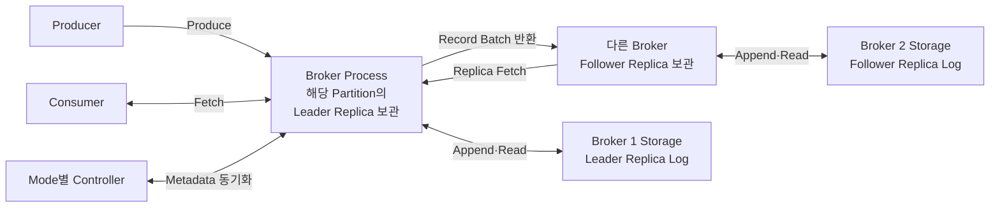
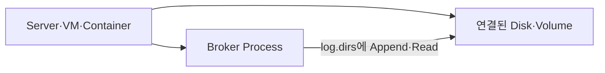
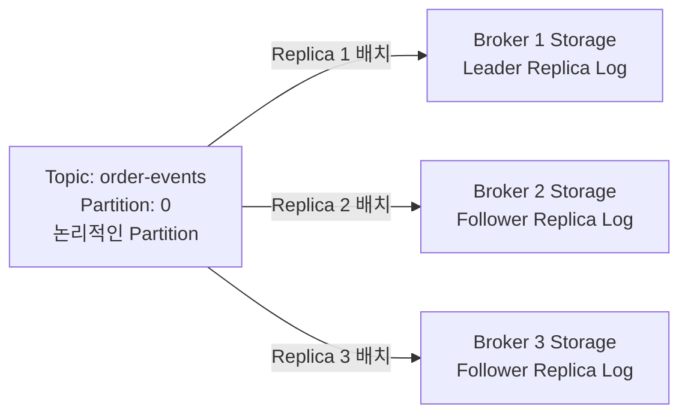
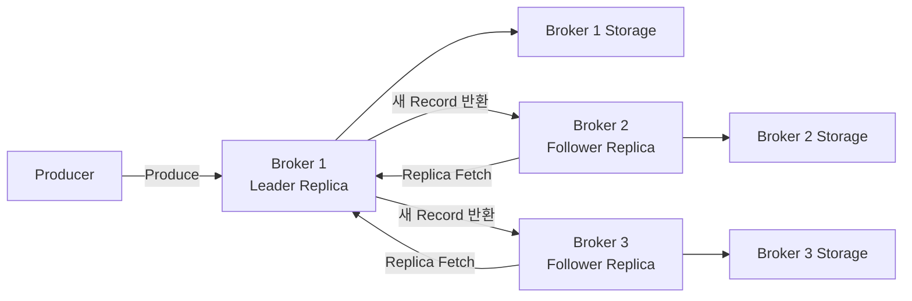
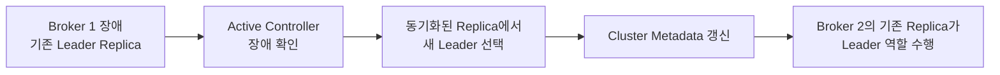
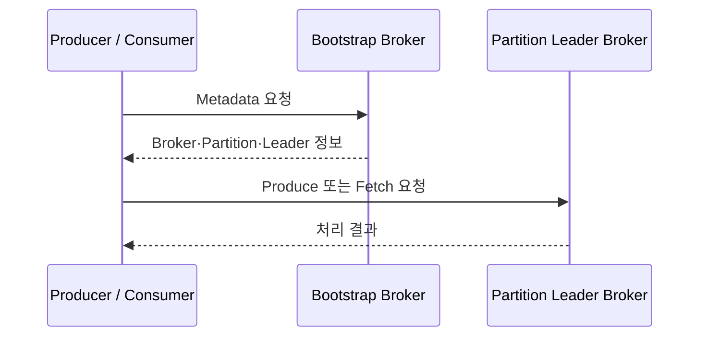
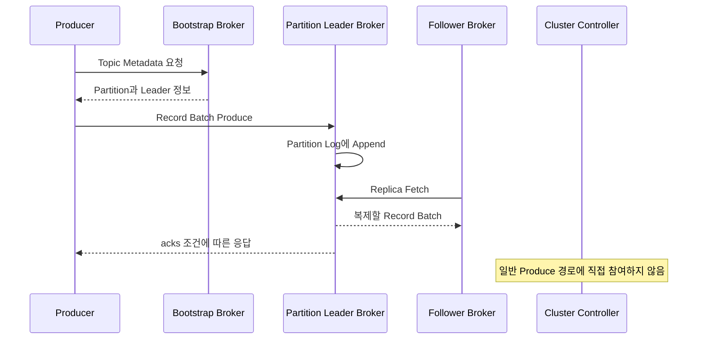

# Apache Kafka Broker와 Cluster 구조

이 문서는 Kafka 서버 프로세스인 Broker부터 시작해 Storage, Cluster, Partition Replica 배치, Cluster Metadata, Controller, Record 요청 경로를 정리합니다.

전체 읽기 순서는 [Kafka 학습 가이드](KAFKA_STUDY_GUIDE.md)를 참고하세요.

Producer가 Record를 구성하고 Partition Leader를 찾는 과정은 [Kafka Producer](KAFKA_PRODUCER.md)에서 먼저 볼 수 있습니다.

ZooKeeper와 KRaft는 별도 글로 분리했습니다.

- [ZooKeeper Mode - 과거의 Kafka Control Plane](KAFKA_ZOOKEEPER_MODE.md)
- [KRaft Mode - 현재의 Kafka Control Plane](KAFKA_KRAFT_MODE.md)

```text
Broker
→ Broker가 사용하는 Storage
→ Cluster
→ Topic·Partition Replica의 배치
→ Cluster Metadata
→ Controller
→ Record 요청 경로
```

---

## 1. Broker란 무엇인가

Broker는 Kafka Cluster에 참여해 Record를 저장하고 Client 요청을 처리하는 Kafka 서버 프로세스입니다. Producer가 보낸 Record를 자신에게 할당된 Partition Replica Log에 저장하고, Producer의 쓰기 요청과 Consumer의 읽기 요청을 처리합니다.

각 Broker는 Cluster 안에서 고유한 ID로 구분합니다. ZooKeeper Mode에서는 `broker.id`, KRaft Mode에서는 `node.id`를 사용합니다.

### Broker의 주요 역할



위 그림은 하나의 Partition을 기준으로 Broker의 관계를 표현한 것입니다. Broker 자체가 항상 Leader 또는 Follower로 고정되는 것은 아닙니다. 같은 Broker도 어떤 Partition의 Leader Replica를 보관하면서 다른 Partition의 Follower Replica를 보관할 수 있습니다.

역할을 나누면 다음과 같습니다.

- **모든 Broker의 기본 역할**: 자신에게 할당된 Partition Replica를 Storage에 저장하고, 확정된 Cluster Metadata를 로컬에 반영합니다.
- **Partition 역할에 따른 동작**: Leader Replica를 가진 Broker는 Produce·Fetch 요청과 Follower의 Replica Fetch를 처리합니다. Follower Replica를 가진 Broker는 Leader에게 Record를 요청해 자신의 Log에 추가합니다.
- **추가로 배정될 수 있는 역할**: 특정 Broker는 Consumer Group의 Group Coordinator나 Transaction Coordinator 역할도 맡습니다.

Broker 한 대가 모든 역할을 독점하는 것은 아닙니다. Partition Leader, Group Coordinator, Transaction Coordinator 역할은 데이터와 요청에 따라 여러 Broker에 분산됩니다.

### Broker가 Storage에 저장하는 것

논리적으로는 Broker마다 자신이 사용하는 Storage가 있습니다. 물리적으로는 Broker Process가 실행되는 서버·VM·Container에 연결된 Disk나 Volume의 `log.dirs` 경로를 사용하는 것입니다. Broker Process 자체에 Disk가 들어 있는 것은 아닙니다.



Kafka Cluster 전체가 하나의 공용 Storage를 사용하는 구조가 아닙니다. 각 Broker가 사용하는 Storage를 합쳐서 Cluster의 전체 저장 공간을 구성합니다. Broker 하나가 여러 `log.dirs`를 통해 여러 Disk를 사용할 수도 있습니다.

Broker는 자신에게 할당된 Partition Replica의 Log를 `log.dirs` 아래에 저장합니다.

```text
Broker 1
└── log.dirs
    ├── order-events-0
    │   ├── 00000000000000000000.log
    │   ├── 00000000000000000000.index
    │   └── 00000000000000000000.timeindex
    └── payment-events-1
        ├── 00000000000000000000.log
        ├── 00000000000000000000.index
        └── 00000000000000000000.timeindex
```

`order-events-0`은 `order-events` Topic의 Partition 0 Replica Log를 나타내는 표기입니다. 하나의 Broker는 여러 Topic의 여러 Partition Replica를 함께 저장할 수 있습니다.

`__consumer_offsets` 같은 내부 Topic도 별도의 특별한 저장소에 보관되지 않습니다. 일반 Topic처럼 Partition과 Replica를 가지며, 각 Replica가 할당된 Broker의 Storage에 저장됩니다. `__consumer_offsets`는 최신 Consumer Offset을 유지하기 위해 Compaction되는 내부 Topic입니다.

---

## 2. Cluster란 무엇인가

Kafka Cluster는 Kafka Node들이 하나의 Kafka 시스템으로 동작하는 구성입니다. 여기서 Node는 Cluster에 참여하는 Kafka Process 하나를 넓게 부르는 표현입니다.

현재 KRaft 구조에서는 Kafka Node가 다음 역할 중 하나 이상을 가집니다.

```text
Kafka Node
├── Broker Node     -> Record 저장과 Client 요청 처리
├── Controller Node -> Cluster Metadata 관리
└── Combined Node   -> Broker와 Controller 역할을 함께 수행
```

따라서 모든 Broker는 Kafka Node이지만, 모든 Kafka Node가 반드시 Broker인 것은 아닙니다. `process.roles=controller`로만 실행된 Controller 전용 Node도 같은 Kafka Cluster에 참여하기 때문입니다.

개발 환경에서는 하나의 Process가 Broker와 Controller 역할을 함께 맡는 Combined Mode를 사용할 수 있습니다. 중요한 운영 환경에서는 Broker Node와 Controller Node를 별도 Process와 Host로 분리하는 구성이 일반적입니다. 역할을 분리해도 서로 다른 Cluster가 되는 것은 아닙니다.

### Broker를 여러 대 두는 이유

| 목적 | 설명 |
|---|---|
| 저장 용량 확장 | Partition Replica를 여러 Broker가 사용하는 Storage에 분산 |
| 처리량 확장 | 여러 Partition Leader가 Produce·Fetch 요청을 병렬 처리 |
| 장애 대응 | Replica를 다른 Broker에 두어 한 Broker 장애에 대응 |
| 부하 분산 | Network, Disk I/O, CPU 부하를 여러 Broker에 분산 |

Broker 수를 늘린다고 하나의 Partition이 자동으로 여러 Broker에서 동시에 쓰기 처리되는 것은 아닙니다. 하나의 Partition에는 한 시점에 하나의 Leader Replica가 있고, 그 Leader가 기본적인 읽기와 쓰기를 담당합니다.

### Topic·Partition과 Broker는 계층 관계가 아니다

Topic과 Partition은 데이터를 나누는 논리 구조이고, Broker와 Storage는 Partition Replica를 실제로 보관하는 실행·저장 구조입니다.

```text
논리 구조
Topic
└── Partition
    └── Record

실행·저장 구조
Kafka Cluster
└── Broker
    └── 해당 Broker에 할당된 Partition Replica Log
```

따라서 Topic 아래에 Broker가 있거나 Topic 전체가 Broker 한 대에 소속되는 것이 아닙니다. **Partition의 Replica가 여러 Broker에 배치되는 관계**입니다.

### Partition Replica와 Leader 역할

Replication Factor가 3이라면 하나의 Partition은 Leader를 포함해 총 세 개의 Replica를 가집니다. Leader Replica가 원본이고 그 밖에 Replica가 세 개 더 있는 것이 아닙니다.



`order-events-0`은 `order-events` Topic의 0번 Partition을 가리키는 표현입니다. 이벤트 이름이 아니라 `Topic + Partition 번호`의 조합입니다.

`Leader Broker`는 Cluster 전체에서 고정된 역할이 아닙니다. 특정 Partition의 Leader Replica를 보관한 Broker를 그 Partition의 Leader Broker라고 줄여 부르는 것입니다.

```text
Broker 1
├── order-events-0: Leader Replica
├── order-events-1: Follower Replica
└── payment-events-0: Leader Replica
```

Partition Leader가 특정 Broker에 몰리면 그 Broker의 요청 처리 부하도 커지므로 Replica 배치뿐 아니라 Leader 분산도 중요합니다.

### Leader-Follower Replication

Kafka는 Broker 장애가 발생한 뒤에 처음 복제하는 것이 아닙니다. Broker가 정상일 때부터 같은 Partition의 Follower Replica들이 Leader Replica의 Record를 지속적으로 가져와 각자의 Storage에 저장합니다.



Replication은 Leader가 다른 Broker의 Storage에 직접 밀어 넣는 방식이 아니라, Follower Replica를 보관한 Broker가 Leader에 `Replica Fetch` 요청을 보내는 Pull 방식입니다.

```text
Active Controller
= Replica 배치와 Partition Leader 변경을 결정

Broker
= 실제 Record를 Fetch하고 자신의 Storage에 복제
```

Leader Broker가 장애 나면 Controller는 이미 동기화되어 있던 Replica 중 새 Leader를 정합니다. 장애가 난 뒤 죽은 Broker의 Storage를 복사해 새 Leader를 만드는 것이 아닙니다.



---

## 3. Cluster Metadata

Kafka Cluster와 Cluster Metadata는 서로 다른 개념입니다.

| 구분 | 의미 |
|---|---|
| Kafka Cluster | Broker, Controller, Storage 등이 함께 동작하는 실제 시스템 |
| Cluster Metadata | 그 시스템의 구성과 현재 상태를 설명하는 정보 |

Cluster Metadata는 별도의 Cluster나 서버가 아니라 Kafka Cluster의 현재 구조를 표현한 데이터입니다.

대표적으로 다음과 같은 정보가 포함됩니다.

```text
어떤 Broker가 Cluster에 등록되어 있는가
어떤 Topic과 Partition이 존재하는가
각 Partition의 Replica는 어느 Broker에 배치되어 있는가
각 Partition의 현재 Leader는 누구인가
Topic과 Broker에 어떤 설정이 적용되어 있는가
어떤 Broker가 현재 사용 가능한 상태인가
```

Metadata는 실제 Event Record와 다릅니다.

| 데이터 | 예시 | 주된 저장·관리 위치 |
|---|---|---|
| Event Data | `ORDER_CREATED`, 주문 JSON | Broker의 Partition Log |
| Cluster Metadata | Topic, Partition, Replica, Leader 정보 | 과거 ZooKeeper 또는 현재 KRaft Metadata Log |
| Consumer Group Metadata | Group 멤버십, Committed Offset | Broker와 `__consumer_offsets` |

### Client Metadata와 Cluster Metadata

두 용어도 구분해야 합니다.

```text
Cluster Metadata
= Kafka Cluster 자체의 구조와 상태 정보

Client Metadata
= Producer와 Consumer가 요청에 필요한 일부 Cluster 정보를 받아 Cache한 것
```

Producer와 Consumer는 `bootstrap.servers`에 적힌 Broker를 시작점으로 연결한 뒤, Broker 목록과 Topic의 Partition Leader 정보를 얻습니다. 이후 모든 요청을 Bootstrap Broker에 보내는 것이 아니라 대상 Partition Leader에 직접 요청합니다.



Controller가 모든 Produce와 Fetch 요청 사이를 중계하지 않는다는 점이 중요합니다.

---

## 4. Controller란 무엇인가

Controller는 Kafka Cluster의 Metadata 변경을 관리하는 역할입니다.

### Controller의 주요 역할

| 역할 | 설명 |
|---|---|
| Broker 등록과 상태 관리 | 해당 Mode의 등록·Session·Heartbeat를 바탕으로 정상 여부 판단 |
| Topic과 Partition 관리 | Topic 생성·삭제와 Partition Metadata 변경 처리 |
| Replica 배치 관리 | Partition Replica를 어느 Broker에 둘지 결정하고 Metadata로 관리 |
| Partition Leader 관리 | 장애나 운영 변경 시 새 Leader 선출과 Metadata 갱신 |
| Cluster 설정 관리 | Cluster 수준의 동적 설정과 관련 Metadata 관리 |
| Metadata 동기화 | 해당 Mode의 방식으로 Broker가 Cluster 상태를 반영하도록 조율 |

Controller가 Partition Log를 직접 복사하는 것은 아닙니다. Controller가 Replica 배치와 Leader 변경을 결정하면, 실제 Record 전송과 복제는 Broker들이 수행합니다.

### 두 종류의 Leader

Kafka 문서에서 Leader라는 단어는 서로 다른 두 대상을 가리킬 수 있습니다. Kafka Cluster 전체를 대표하는 `Broker Leader`라는 역할은 없습니다.

| 구분 | 범위 | 역할 |
|---|---|---|
| Partition Leader Replica | 각 Partition마다 하나 | 해당 Partition의 Record 읽기·쓰기 처리 |
| Active Kafka Controller | Cluster에서 한 시점에 하나 | Cluster Metadata 변경 주도 |

```text
Partition 10개
→ 각 Partition에 Leader Replica가 1개씩 존재하며 Broker들에 분산 가능

Kafka Cluster
→ Kafka Controller 역할은 한 시점에 1개
```

ZooKeeper Mode에서는 Broker 중 하나가 Kafka Controller가 되고, KRaft Mode에서는 Controller Quorum의 Active Controller가 이 역할을 맡습니다. 어느 Mode든 Kafka Controller가 Record를 저장하는 Partition Leader라는 뜻은 아닙니다.

### Data Plane과 Control Plane

Broker와 Controller의 역할을 분산 시스템 용어로 나누면 다음과 같습니다. Data Plane과 Control Plane은 Kafka 구성 요소의 고유 이름이 아니라 역할을 구분하는 일반적인 아키텍처 용어입니다.

| 구분 | 중심 담당 | 주요 역할 |
|---|---|---|
| Data Plane | Broker | Record 저장, Produce·Fetch 요청, Partition 복제 |
| Cluster Control Plane | Mode별 Kafka Controller 구조 | Cluster Metadata 관리, Broker 상태 판단, Partition Leader 변경 |

Record는 Broker의 Partition Log에 저장됩니다. Controller는 Record를 대신 전달하지 않고, Broker와 Partition의 상태를 관리합니다.

---

## 5. Record 요청의 공통 데이터 경로

ZooKeeper와 KRaft는 Cluster Metadata 관리 방식이 다릅니다. 하지만 Producer가 Record를 쓰고 Consumer가 Record를 읽는 Data Plane의 기본 경로는 같습니다.

### Produce 요청



ZooKeeper Mode의 Kafka Controller와 KRaft Mode의 Active Controller 모두 Partition Leader 정보가 바뀔 때 Metadata를 관리하지만, 정상적인 Record 하나하나의 전송 경로에는 들어가지 않습니다.

### Consumer Fetch 요청

```text
Consumer가 할당받은 Partition 확인
→ Client Metadata에서 Partition Leader 확인
→ Leader Broker에 Offset을 포함한 Fetch 요청
→ Broker가 Partition Log에서 Record Batch를 읽어 반환
```

Consumer도 Controller나 ZooKeeper에서 Event Record를 읽지 않습니다.

---

## 6. 핵심 정리

```text
Broker
= Kafka Cluster에 참여하는 Kafka 서버 프로세스
= Partition Replica 저장과 Client 요청 처리

Kafka Cluster
= Broker Node와 Controller Node가 하나의 논리적 시스템으로 동작하는 구성

Cluster Metadata
= Kafka Cluster의 Broker·Topic·Partition·Replica·Leader 구조와 상태를 설명하는 정보

Controller
= Cluster Metadata 변경을 주도하는 역할
```

Record는 각 Broker가 사용하는 Storage의 Partition Replica Log에 저장됩니다. Follower Broker가 Leader Broker에서 Record를 지속적으로 Fetch해 복제하며, Controller는 Replica 배치와 Leader 변경을 관리합니다. Controller는 일반적인 Produce·Fetch 경로에 직접 참여하지 않습니다.

---

## 7. 학습 체크포인트

- Broker는 무엇을 저장하고 어떤 요청을 처리하는가?
- Broker와 Kafka Node는 어떤 관계인가?
- Broker가 사용하는 Storage는 Process, Server, Cluster 중 어디에 속하는가?
- Topic·Partition과 Broker가 계층 관계가 아닌 이유는 무엇인가?
- Partition Replica는 여러 Broker에 어떻게 배치되는가?
- Leader Replica는 Replica 수에 포함되는가?
- Follower Broker는 어떤 방식으로 Leader의 Record를 복제하는가?
- Cluster Metadata와 Event Record는 무엇이 다른가?
- Partition Leader와 Kafka Controller는 무엇이 다른가?
- Producer와 Consumer는 대상 Partition Leader를 어떻게 찾는가?
- Controller가 일반적인 Record 전송 경로에 참여하지 않는 이유는 무엇인가?

---

## 8. 다음 글

- [ZooKeeper Mode - 과거의 Kafka Control Plane](KAFKA_ZOOKEEPER_MODE.md)
- [KRaft Mode - 현재의 Kafka Control Plane](KAFKA_KRAFT_MODE.md)

---

## 9. 공식 문서

- [Apache Kafka 4.3 설계](https://kafka.apache.org/43/design/design/)
- [Apache Kafka 4.3 Broker 설정](https://kafka.apache.org/43/configuration/broker-configs/)
- [Apache Kafka 4.3 KRaft](https://kafka.apache.org/43/operations/kraft/)
