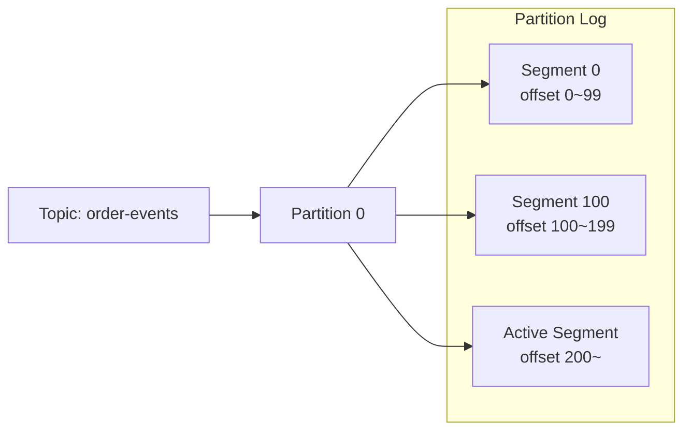
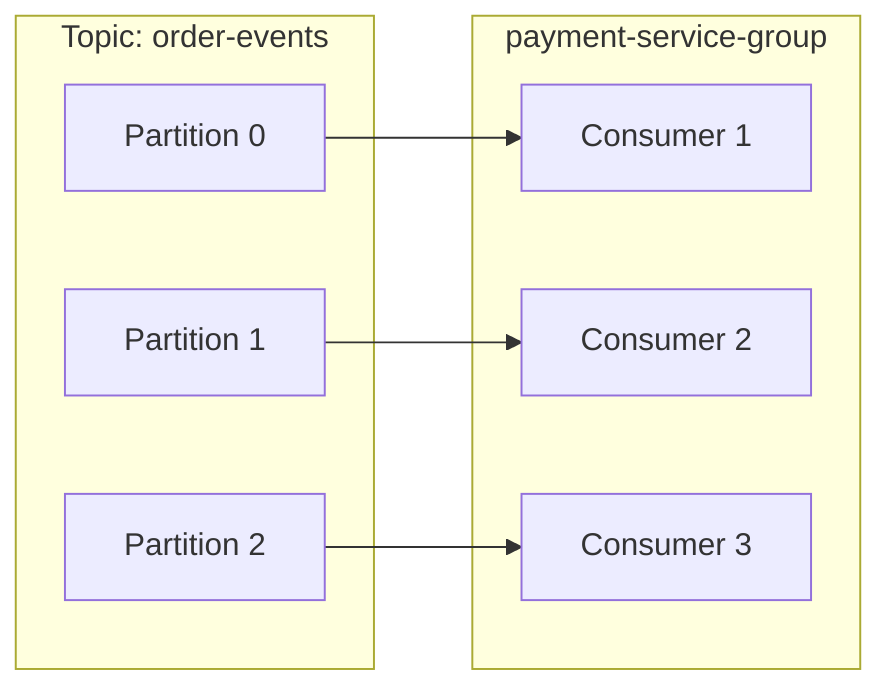
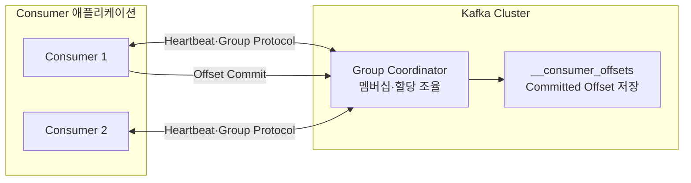
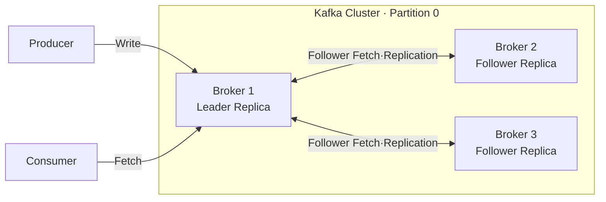
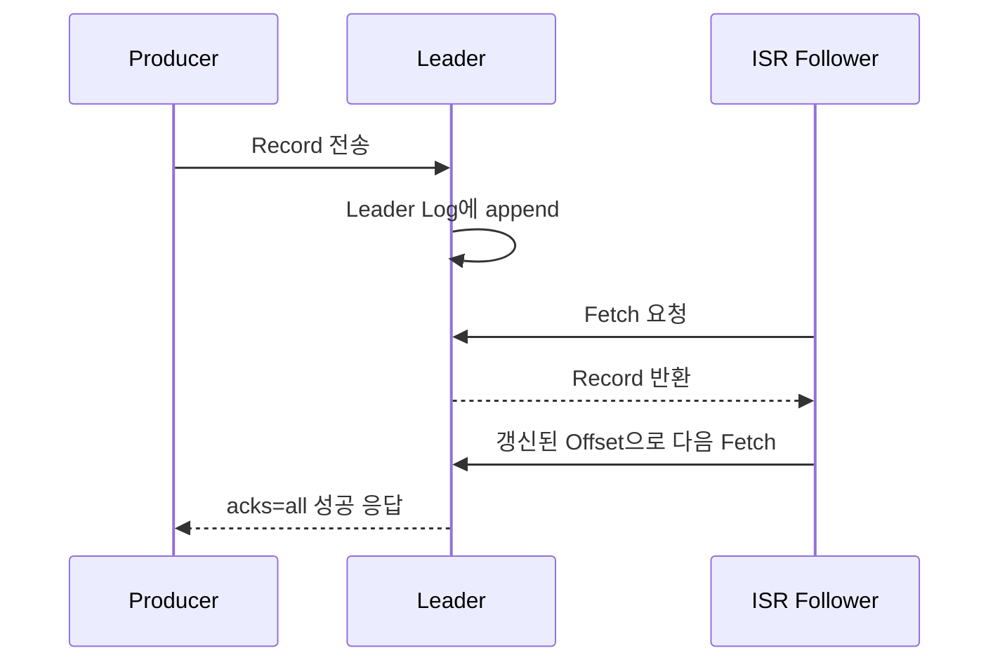
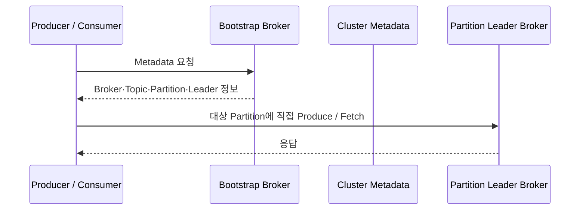
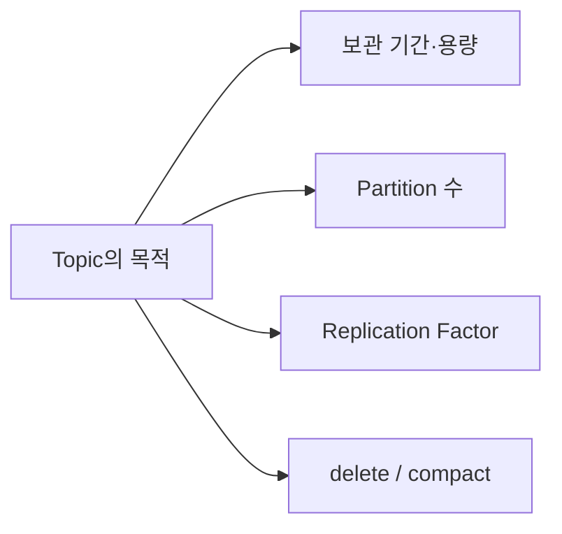
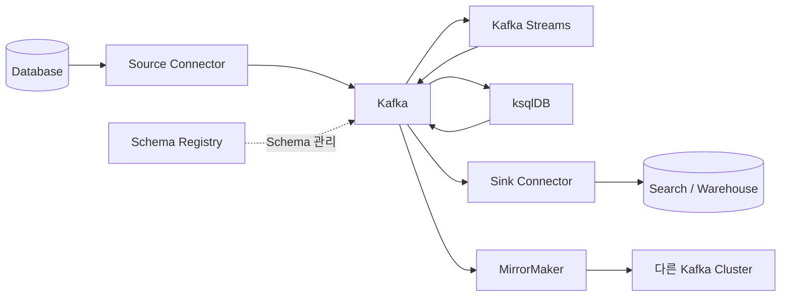

# Apache Kafka 딥다이브

이 문서는 [Kafka 기본 개념](KAFKA_BASIC_CONCEPTS.md)을 이해한 다음 보는 상세 학습 문서입니다.

전체 문서의 추천 읽기 순서는 [Kafka 학습 가이드](KAFKA_STUDY_GUIDE.md)를 참고하세요.

기본 용어를 다시 나열하기보다 Kafka가 데이터를 어떻게 관리하고, 장애와 확장 상황에서 어떻게 동작하는지를 중심으로 정리합니다.

Broker와 Cluster의 기본 구조는 [Kafka Broker와 Cluster 구조](KAFKA_BROKER_AND_CLUSTER.md), 과거와 현재의 Control Plane은 [ZooKeeper Mode](KAFKA_ZOOKEEPER_MODE.md)와 [KRaft Mode](KAFKA_KRAFT_MODE.md)에 각각 정리합니다.

Producer의 Record 구성, Partition 선택, 전송 결과, `acks`와 안전한 종료는 [Kafka Producer](KAFKA_PRODUCER.md)에 정리합니다.

---

## 1. Partition Log와 Segment

### Segment 파일 구조

Partition은 논리적으로 하나의 순서 있는 Log지만, Broker가 사용하는 Storage에서는 여러 Segment로 나뉘어 저장됩니다.



Segment는 보통 다음 파일들을 함께 가집니다.

```text
00000000000000000100.log        Record 데이터
00000000000000000100.index      Offset 인덱스
00000000000000000100.timeindex  Timestamp 인덱스
```

파일 이름은 해당 Segment에 처음 저장된 Record의 Base Offset을 사용합니다. 새로운 Record는 현재 열려 있는 Active Segment에만 append됩니다.

Segment가 설정된 크기나 시간을 넘으면 새 Segment로 전환되는데, 이를 Segment Roll이라고 합니다.

### Retention과 cleanup.policy

Consumer가 읽었다는 이유로 Record가 삭제되지는 않습니다. 데이터 정리는 Topic의 `cleanup.policy`와 Retention 설정을 기준으로 수행됩니다.

```text
cleanup.policy
├── delete          : 오래된 Segment 삭제
├── compact         : Key별 최신 상태를 중심으로 유지
└── delete,compact  : 보관 기간·용량 정리와 Compaction을 함께 적용
```

`delete` 정책에서는 시간이나 용량 조건을 만족한 오래된 Segment를 통째로 삭제합니다. Active Segment의 Record를 한 건씩 삭제하는 방식이 아닙니다.

- `retention.ms`: 데이터를 보관할 시간
- `retention.bytes`: Partition별로 보관할 최대 용량
- `delete.retention.ms`: Compacted Topic의 Tombstone을 보관할 시간
- `segment.bytes`: Segment가 Roll될 크기 기준
- `segment.ms`: Segment가 Roll될 시간 기준

`compact` 정책은 같은 Key의 변경 이력 중 최신 값을 중심으로 남기는 방식입니다. Value가 `null`인 Tombstone Record는 해당 Key의 삭제를 표현하며, `delete.retention.ms` 동안 보관된 뒤 나중에 정리될 수 있습니다. Compaction은 즉시 실행되지 않으므로 정리 과정에서는 이전 값과 Tombstone이 함께 존재할 수 있습니다.

```text
order-123 -> CREATED
order-123 -> PAID
order-123 -> CANCELLED

Compaction 이후 유지할 최종 상태
order-123 -> CANCELLED
```

---

## 2. Consumer Group 내부 동작

### Consumer와 Partition 할당

아래 설명은 일반 Consumer Group(classic 또는 consumer protocol) 기준입니다. Kafka 4.2부터 production-ready가 된 Share Group은 같은 Partition을 여러 Consumer가 공유하고 Record 단위의 처리 확인을 사용하므로, 일반 Consumer Group과 할당 규칙이 다릅니다.

같은 Consumer Group의 Consumer들은 Topic의 Partition을 나누어 읽습니다. 한 시점에 하나의 Partition은 같은 Group 안의 Consumer 하나에만 할당됩니다.



Consumer 수가 Partition 수보다 많으면 남는 Consumer는 할당받을 Partition이 없어 대기합니다. Consumer 수만 늘려서는 Partition 수보다 높은 병렬성을 얻을 수 없습니다.

### Group Coordinator와 Offset 저장

Consumer는 애플리케이션 서버 안에서 실행되지만, Consumer Group 조정은 Kafka Broker가 담당합니다.



`__consumer_offsets`는 Kafka 내부의 compacted Topic입니다. 일반 Topic처럼 Partition과 Replica를 가지며, 다음 조합을 기준으로 Consumer Group의 Committed Offset을 저장합니다. Group Coordinator는 빠른 Offset 조회를 위해 이 값을 메모리에도 캐시합니다.

```text
(group.id, topic, partition) -> committed offset
```

Consumer의 실행 중 위치와 Kafka에 저장된 위치는 다를 수 있습니다.

```text
Current Position
= 실행 중인 Consumer가 다음에 읽을 위치

Committed Offset
= 장애나 재할당 이후 다시 시작할 기준으로 Kafka에 저장한 위치
```

Kafka는 결제나 재고 차감 같은 비즈니스 로직의 성공 여부를 직접 확인하지 않습니다. Consumer가 처리와 Commit의 순서를 결정해야 합니다.

### Rebalance

Rebalance는 Consumer Group의 Partition 할당을 다시 계산하는 과정입니다.

```text
Consumer 추가·제거 / Partition 수 변경 / 세션 만료
                         ↓
                     Rebalance
                         ↓
          기존 할당 회수 → Partition 재할당
                         ↓
             Committed Offset부터 재개
```

Rebalance 중에는 일부 처리가 잠시 멈추거나 지연될 수 있습니다. Consumer 종료 처리, Heartbeat 설정, 처리 시간, 할당 전략이 운영 안정성에 영향을 줍니다.

### Consumer Lag

Consumer Lag은 일반적으로 Partition의 Log End Offset과 Consumer Group의 Committed Offset 차이로 관찰합니다.

```text
Log End Offset   = 1,000
Committed Offset =   850
Consumer Lag     =   150
```

Lag이 증가한다고 항상 장애인 것은 아닙니다. Producer 유입량, Consumer 처리량, 일시적 배치 작업을 함께 봐야 합니다. Lag이 계속 증가한다면 Partition 병렬성, Consumer 처리 속도, 외부 시스템 지연을 점검합니다.

---

## 3. Replication과 데이터 안정성

### Leader, Follower, ISR

Kafka는 Partition 단위로 Replica를 만들고 서로 다른 Broker에 배치합니다.



- `Replication Factor`: Partition이 가질 전체 Replica 수
- `Leader Replica`: 일반적인 읽기와 쓰기 요청을 처리하는 Replica
- `Follower Replica`: Leader의 Log를 가져와 복제하는 Replica
- `ISR`: Leader를 충분히 따라가고 있어 Leader 후보가 될 수 있는 Replica 집합
- `ELR`: ISR 밖에 있더라도 High Watermark까지 안전하게 보유해 Leader 후보가 될 수 있도록 별도로 추적되는 Replica 집합

ISR에는 현재 Leader도 포함됩니다. Follower가 Leader를 일정 시간 이상 따라가지 못하면 ISR에서 제외될 수 있습니다.

Replication Factor가 3이라고 해서 Broker 장애 시 무조건 데이터 무손실이 보장되는 것은 아닙니다. `acks`, `min.insync.replicas`, ISR 상태와 Leader 선출 정책을 함께 봐야 합니다. ELR이 활성화된 Kafka 4.x에서는 일반적으로 ISR, ELR, 마지막 Leader 순서로 선출 후보를 검토합니다.

Leader Broker에 장애가 발생하면 보통 ISR의 Follower 중 하나가 새 Leader로 선출되며, 필요한 경우 ELR이 다음 후보가 될 수 있습니다.

### Producer acks

여기서 `acks`는 일반 작업 큐의 Consumer ACK가 아니라, Kafka Producer가 Broker의 저장 성공 응답을 어느 수준까지 기다릴지 정하는 설정입니다.

| 설정 | 성공 판단 기준 | 주요 특성 |
|---|---|---|
| `acks=0` | Broker 응답을 기다리지 않음 | 빠르지만 전송 성공을 확인하지 못함 |
| `acks=1` | Leader에 기록되면 응답 | Follower 복제 전에 Leader가 장애 나면 유실 가능 |
| `acks=all` | 현재 ISR의 모든 Replica가 acknowledge한 뒤 응답 | `min.insync.replicas`가 부족하면 쓰기 실패 |



### min.insync.replicas

`acks=all`만 사용한다고 항상 원하는 복제 수준이 보장되는 것은 아닙니다. `min.insync.replicas`는 쓰기를 허용하기 위해 필요한 최소 ISR 수를 정합니다.

```text
Replication Factor = 3
min.insync.replicas = 2
Producer acks       = all

ISR 3개 -> 3개 Replica의 acknowledge 후 쓰기 성공
ISR 2개 -> 2개 Replica의 acknowledge 후 쓰기 성공
ISR 1개 -> 최소 ISR 조건 위반으로 쓰기 실패
```

가용성과 내구성은 서로 영향을 줍니다. 필요한 ISR 수를 높이면 데이터 안정성은 강해지지만, 장애 상황에서 쓰기가 중단될 가능성도 커집니다.

---

## 4. Client Metadata와 Broker 통신

Producer와 Consumer는 모든 요청을 처음 연결한 Broker 한 대에 보내지 않습니다. `bootstrap.servers`는 Cluster에 처음 진입해 Metadata를 얻기 위한 주소입니다.



Client Metadata에는 Broker 주소, Topic의 Partition, 각 Partition의 Leader 같은 정보가 포함됩니다. Leader가 변경되거나 Metadata가 오래되면 Client는 Metadata를 갱신하고 새 Leader와 통신합니다.

Producer는 이 Metadata와 Message Key를 이용해 대상 Partition과 Leader Broker를 찾습니다. Consumer도 자신에게 할당된 Partition의 Leader Broker에 Fetch 요청을 보냅니다.

---

## 5. Broker와 Cluster 구조

Broker의 데이터 처리와 KRaft Controller의 Metadata 관리는 서로 다른 경로입니다.

```text
Broker Data Plane
└── Partition Log 저장·Produce·Fetch·Replica 복제

KRaft Control Plane
└── Controller Quorum의 Metadata Log 복제·Cluster 변경 관리
```

Broker와 Cluster의 기본 구조는 [Kafka Broker와 Cluster 구조](KAFKA_BROKER_AND_CLUSTER.md)에서 다룹니다. ZooKeeper의 Controller Broker 구조와 KRaft의 Controller Quorum·Process Role·장애 흐름은 각각 [ZooKeeper Mode](KAFKA_ZOOKEEPER_MODE.md)와 [KRaft Mode](KAFKA_KRAFT_MODE.md)에서 자세히 다룹니다.

---

## 6. Topic 설계

### Topic 이름

Topic 이름은 생산자 구현보다 Event의 도메인과 의미가 드러나게 정하는 것이 좋습니다.

```text
commerce.order.events.v1
commerce.payment.events.v1
commerce.inventory.events.v1
```

조직에서 환경, 도메인, 데이터 종류, 버전을 어떤 순서로 표현할지 규칙을 정하고 일관되게 사용합니다. 이름만 보고 소유 팀, 데이터 의미, 보관 정책을 추측할 수 있어야 운영이 쉬워집니다.

### Partition 수와 Message Key

Partition 수는 다음 요소에 영향을 줍니다.

- Consumer Group의 최대 병렬 처리 범위
- Broker 간 데이터 분산
- Key 기준 순서 보장 범위
- Metadata와 파일 수에 따른 운영 비용

기본 파티셔닝에서는 같은 Key가 같은 Partition으로 배정됩니다. 하지만 Partition 수가 변경되면 이후 같은 Key가 이전과 다른 Partition으로 갈 수 있으므로, 순서가 중요한 Topic의 Partition 증가는 신중하게 결정해야 합니다.

### Topic별 정책

모든 Topic에 같은 설정을 적용할 필요는 없습니다.



재처리가 필요한 Event Log, 최신 상태가 중요한 Compact Topic, 짧게 유지하는 임시 데이터는 서로 다른 정책을 가져야 합니다.

---

## 7. Kafka 생태계

Kafka 주변 도구는 데이터 입출력, 스트림 처리, 스키마 관리, Cluster 간 복제를 담당합니다.



- `Kafka Connect`: 외부 시스템과 Kafka 사이의 반복적인 데이터 이동을 Connector로 구성
- `Source Connector`: 외부 데이터를 Kafka로 가져옴
- `Sink Connector`: Kafka 데이터를 외부 시스템으로 내보냄
- `Kafka Streams`: Kafka Record를 애플리케이션 코드에서 처리하는 Java 라이브러리
- `ksqlDB`: Kafka Event Stream을 SQL 형태로 처리하는 도구
- `Schema Registry`: Record의 스키마와 호환성 규칙을 관리하는 별도 생태계 도구
- `MirrorMaker`: Kafka Cluster 사이에서 Topic 데이터를 복제

Kafka Connect, Kafka Streams, MirrorMaker는 Apache Kafka 프로젝트에 포함됩니다. ksqlDB와 Schema Registry는 Kafka 자체 핵심 구성 요소가 아니라 Kafka와 함께 자주 사용되는 생태계 도구입니다.

---

## 8. 딥다이브 학습 순서

```text
Partition Log · Segment · Retention
                ↓
Consumer Group · Commit · Rebalance · Lag
                ↓
Replication · ISR · acks · min.insync.replicas
                ↓
Client Metadata · Broker 통신
                ↓
Broker · Cluster · KRaft 구조
                ↓
Kafka Connect · Streams · 생태계
```

기본 문서의 흐름을 설명할 수 있다면, 이 문서는 위 순서대로 하나씩 실습과 설정값을 붙이며 공부하면 됩니다.

## 공식 문서

- [Apache Kafka 4.3 Topic Configs](https://kafka.apache.org/43/configuration/topic-configs/)
- [Apache Kafka 4.3 Consumer Offset Tracking](https://kafka.apache.org/43/implementation/distribution/)
- [Apache Kafka 4.3 Eligible Leader Replicas](https://kafka.apache.org/43/operations/eligible-leader-replicas/)
