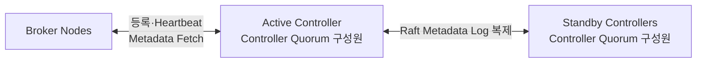
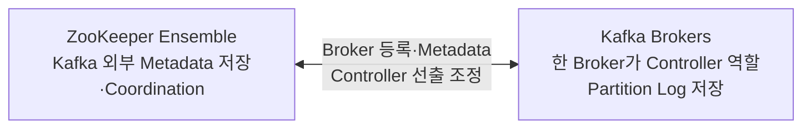
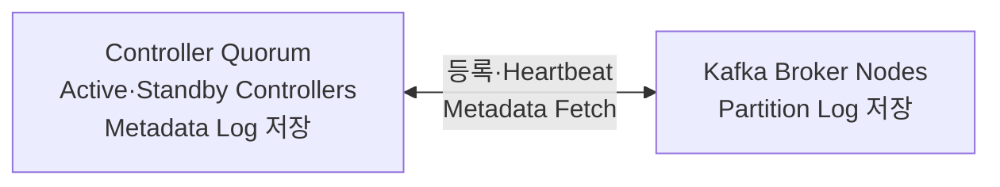
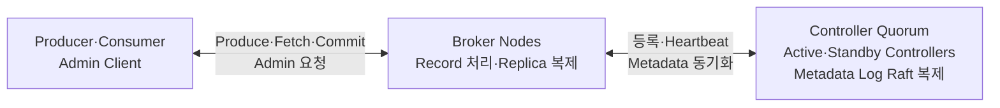

# Apache Kafka KRaft Mode

이 문서는 현재 Kafka가 ZooKeeper 없이 Cluster Metadata를 관리하는 KRaft 구조를 정리합니다.

먼저 [Broker와 Cluster 기본 구조](KAFKA_BROKER_AND_CLUSTER.md)를 읽고, 과거 구조가 필요한 경우 [ZooKeeper Mode](KAFKA_ZOOKEEPER_MODE.md)를 함께 보면 차이가 선명해집니다.

전체 읽기 순서는 [Kafka 학습 가이드](KAFKA_STUDY_GUIDE.md)를 참고하세요.

```text
Controller Node
→ Controller Quorum
→ Active·Standby Controller
→ Broker 등록과 Heartbeat
→ Metadata Log
→ 장애 대응
```

---

## 1. 현재의 KRaft 방식

KRaft는 Kafka가 ZooKeeper 없이 Cluster Metadata를 자체적으로 관리하는 방식입니다. 이름은 Kafka와 Raft를 합친 표현입니다.

Kafka 4.0부터 ZooKeeper 모드는 제거되었으므로, 새로운 Kafka Cluster는 KRaft 구조를 기준으로 이해해야 합니다.

### KRaft는 별도의 서버가 아니다

KRaft라는 별도 프로그램이나 `KRaft Server`를 추가로 설치하는 것은 아닙니다. Kafka Controller Process들이 Raft를 사용해 Metadata에 합의하는 구조를 KRaft라고 부릅니다.

```text
Kafka Controller Process들
+ Raft 합의와 Metadata Log 복제
= KRaft Controller Quorum
```

### Controller Node, Quorum, Active Controller

| 용어 | 정확한 의미 |
|---|---|
| Controller Node | `process.roles=controller`로 실행된 실제 Kafka 서버 프로세스 |
| Controller Quorum | Metadata Log의 Raft 합의에 참여하는 Controller Node 구성 |
| Quorum 조건 | Metadata를 Commit하거나 선거를 진행하는 데 필요한 정족수, 일반적으로 과반수 |
| Active Controller | Raft 선거로 뽑힌 현재 Metadata Log Leader |
| Standby Controller | Metadata Log를 복제하며 다음 선거에 대비하는 Controller |

`Controller Quorum`은 Nginx나 Load Balancer처럼 앞에서 요청을 분산하는 별도 서버가 아닙니다. 서로 다른 Host나 VM에서 실행되는 Controller Process들이 직접 통신하며 하나의 Raft 그룹을 이루는 구조입니다.

```text
하나의 Kafka Cluster
├── Host 1 -> Controller Process 1
├── Host 2 -> Controller Process 2
├── Host 3 -> Controller Process 3
├── Host 4 -> Broker Process 1
├── Host 5 -> Broker Process 2
└── Host 6 -> Broker Process 3
```

위 Controller Process들은 서로 다른 Kafka Cluster가 아니라, 같은 Kafka Cluster의 Controller Node들입니다. Kafka Cluster를 여러 개 운영한다면 각 Cluster는 서로 독립적인 Controller Quorum을 가집니다.

### KRaft의 핵심 통신 구조



Controller들은 Metadata Log를 Raft 방식으로 복제합니다. 그중 한 Controller가 Active Controller가 되어 Metadata 변경을 주도하고, 나머지는 Commit된 Metadata를 복제한 Standby Controller로 대기합니다.

Broker 등록과 Heartbeat는 Active Controller가 처리합니다. Broker는 확정된 Metadata 변경도 Active Controller에서 Fetch해 로컬 상태에 적용합니다.

### Active Controller는 어떻게 정해지는가

운영자가 특정 Controller Node에 `active=true`처럼 Active 역할을 고정하지 않습니다. 각 Controller Process에는 `process.roles=controller`와 통신 주소를 설정하고, 실제 Active Controller는 Raft 선거로 자동 결정됩니다.

```text
Controller 1·2·3 실행
→ Controller Listener를 통해 서로 통신
→ Controller 중 하나가 선거 시작
→ 다른 Controller에 투표 요청
→ 과반수 표를 얻은 Controller가 Active Controller가 됨
→ 나머지는 Standby Controller로 Metadata Log 복제
```

Controller가 3개라면 2개의 표가 과반수입니다.

```text
Controller 1: Standby
Controller 2: Active
Controller 3: Standby
```

네트워크가 `Controller 1`과 `Controller 2·3`으로 분리되면, 과반수인 2개가 통신 가능한 쪽만 Active Controller를 선출할 수 있습니다. 1개만 고립된 쪽에서는 Active를 선출할 수 없으므로 두 개의 Active가 생기는 Split Brain을 방지합니다.

Controller Node가 하나뿐이면 후보도 하나이므로 해당 Controller가 Active가 됩니다. 이 Process가 중단되면 대체할 Node가 없어 장애 허용 수는 0입니다.

### Broker와 Controller의 Process Role

Kafka Node는 Cluster에 참여하는 Kafka Process를 넓게 부르는 표현이며, KRaft Node는 `process.roles` 설정으로 역할을 정합니다. 모든 Broker는 Kafka Node이지만 Controller 전용 Node는 Broker가 아닙니다.

| 설정 | 역할 |
|---|---|
| `process.roles=broker` | Broker 전용 Node |
| `process.roles=controller` | Controller 전용 Node |
| `process.roles=broker,controller` | 두 역할을 함께 수행하는 Combined Node |

개발이나 작은 실습 환경에서는 Combined Mode가 단순합니다. 이 경우 Kafka Process 하나가 Broker 역할과 Controller 역할을 논리적으로 함께 수행합니다.

```text
개발 환경 예시
Node 1: Broker + Controller
Node 2: Broker + Controller
Node 3: Broker + Controller
```

중요한 운영 환경에서는 Broker의 Data 부하와 Controller의 Metadata 관리를 격리하고 각각 확장·재시작할 수 있도록 역할을 분리하는 구성이 일반적입니다. 별도 Process와 Host로 분리하더라도 Broker와 Controller는 같은 Kafka Cluster에 참여합니다.

```text
운영 환경 예시
Host 1, 2, 3    -> Controller 전용 Process
Host 4, 5, 6... -> Broker 전용 Process
```

Controller 전용 Process의 설정은 개념적으로 다음과 같습니다. 아래 예시는 Kafka 4.1부터 지원되는 Dynamic KRaft Quorum 기준입니다.

```properties
process.roles=controller
node.id=1
listeners=CONTROLLER://:9093
controller.listener.names=CONTROLLER
controller.quorum.bootstrap.servers=controller-1:9093,controller-2:9093,controller-3:9093
```

`controller-2`, `controller-3`도 같은 Controller 주소 목록을 사용하고, 각 Node의 `node.id`와 Listener Host는 서로 달라야 합니다. Broker Node에도 동일한 `controller.quorum.bootstrap.servers` 목록을 설정해 Controller Quorum을 발견하게 합니다.

### Kafka Cluster의 처음 실행 순서

KRaft Cluster가 처음 시작할 때는 다음 순서로 연결됩니다.

```text
1. 같은 Cluster ID로 Kafka Storage 준비
2. Controller Process들이 실행되고 서로 발견
3. Raft 선거로 Active Controller 선출
4. Broker Process가 실행되고 Active Controller 발견
5. Broker가 자신을 Cluster 구성원으로 등록
6. Broker 등록이 Metadata Log에 Commit되고 Broker Epoch 발급
7. Broker가 Metadata 동기화와 Partition Log 복구 수행
8. Broker가 Heartbeat로 준비 완료를 알리고 활성화
9. Topic·Partition이 존재하면 Partition Leader 상태 관리
```

여기서 등록되는 것은 `Broker Leader`가 아니라 Broker Process 자체입니다. Kafka Cluster 전체를 대표하는 Broker Leader는 없습니다.

```text
Broker 등록
= 이 Broker Process가 Cluster 구성원으로 존재함을 등록

Partition Leader 선출
= 각 Partition Replica 중 Record 요청을 처리할 대표를 결정
```

새 Cluster에 Topic이 하나도 없다면 Broker만 등록될 뿐, 아직 관리할 Partition Leader도 없습니다. Topic이 생성되고 Partition과 Replica가 배치된 뒤에 Partition Leader가 생깁니다.

### Broker 등록

Broker는 시작하거나 재시작할 때 Active Controller에 등록 요청을 보냅니다.

```text
BrokerRegistrationRequest
├── node.id
├── 현재 Broker Process를 구분하는 Incarnation ID
├── Listener 주소
├── Rack과 Log Directory 정보
└── Broker가 지원하는 Feature 정보
```

Active Controller는 Broker 등록을 Metadata Record로 만들고 Controller Quorum에서 Commit합니다. 등록이 성공하면 Broker ID의 실행 세대를 구분하는 Broker Epoch가 발급됩니다.

```text
이전 Broker Process: node.id=101, broker epoch=7
새 Broker Process:   node.id=101, broker epoch=12
```

Broker Epoch를 이용하면 장애가 났던 이전 Process가 뒤늦게 요청을 보내더라도 현재 Process의 요청과 구분할 수 있습니다.

Broker는 등록되자마자 Client 요청을 처리하는 것이 아니라 처음에는 Fenced 상태로 시작합니다.

```text
Unregistered
→ Registered + Fenced
→ Metadata 동기화·Log 복구
→ Registered + Unfenced
```

Fenced는 Broker 등록 정보는 남아 있지만 정상 Broker로 사용하지 않는 상태입니다. Broker가 충분히 최신 Metadata를 반영하고 시작 준비를 마치면 Active Controller가 Unfenced 상태로 전환합니다.

### Broker Heartbeat

등록된 Broker는 주기적으로 Active Controller에 Heartbeat를 보내 Lease를 갱신합니다. 모든 Standby Controller에 각각 보내는 것이 아니라 현재 Active Controller가 Broker Heartbeat를 처리합니다.

```text
BrokerHeartbeatRequest
├── Broker ID와 Broker Epoch
├── Broker가 현재까지 반영한 Metadata Offset
├── Fenced 상태를 원하는지 여부
└── Controlled Shutdown을 원하는지 여부
```

Active Controller는 Heartbeat를 통해 다음을 판단합니다.

```text
Heartbeat 정상
→ Broker Lease 갱신
→ Metadata 동기화와 준비가 끝났다면 Unfenced 유지

Heartbeat 중단
→ Broker Lease 만료
→ Broker를 Fenced 처리
→ 필요한 Partition Leader 변경 수행
```

Kafka 4.3 기본 설정에서는 `broker.heartbeat.interval.ms`가 2초이고 `broker.session.timeout.ms`가 9초입니다. 이 Broker Heartbeat는 Consumer Group에서 Consumer 생존을 확인하는 Heartbeat와는 서로 다른 통신입니다.

### Metadata 변경은 Broker가 Fetch한다

KRaft에서 Active Controller가 모든 Broker에 Metadata를 일방적으로 Push하는 것은 아닙니다. Broker가 자신이 마지막으로 반영한 Metadata Offset 이후의 Commit된 변경분을 Fetch합니다.

```text
Topic 생성 또는 Broker 장애
→ Active Controller가 Metadata Record 생성
→ Controller Quorum에 복제
→ 과반수 복제로 Commit
→ Broker가 Active Controller에 Metadata Fetch 요청
→ Active Controller가 Commit된 Metadata 변경분 응답
→ Broker가 로컬 Metadata 상태에 적용
```

예를 들어 Partition Leader가 변경되면 각 Broker는 변경분을 가져와 자기 역할을 갱신합니다.

```text
Metadata 변경
Partition 0 Leader: Broker 1 -> Broker 2

Broker 1: 더 이상 Leader가 아님을 반영
Broker 2: 새 Leader 역할 시작
Broker 3: 새 Leader 위치를 로컬 Metadata에 반영
```

Producer와 Consumer가 Metadata를 요청하면 Broker는 이 로컬 Metadata를 바탕으로 Broker·Topic·Partition·Leader 정보를 응답합니다.

### Metadata Log

앞 절에서 Controller Quorum에 복제된 것은 Topic 생성, Partition 배치, Broker 등록, Leader 변경 같은 Cluster 상태를 나타내는 Metadata Record입니다. 이 Record들이 순서대로 쌓인 것이 KRaft Metadata Log입니다.

Metadata Log는 Event Record를 저장하는 Topic Partition Log와 목적이 다릅니다.

```text
Partition Log
└── 사용자의 Event Data 저장

KRaft Metadata Log
└── Kafka Cluster의 상태 변경 저장
```

Metadata Log가 계속 무한히 재생되지 않도록 Snapshot도 함께 사용합니다. 새 Controller나 재시작한 Controller는 Snapshot과 이후 Metadata Log를 이용해 현재 Cluster 상태를 구성할 수 있습니다.

### Quorum과 과반수

엄밀히 말해 Quorum은 합의에 필요한 최소 참여 수인 정족수를 뜻합니다. Kafka에서 `Controller Quorum`이라고 할 때는 Raft에 참여하는 Controller 구성 전체까지 함께 가리키는 경우가 많습니다.

Controller Quorum이 Metadata 변경을 확정하려면 과반수 Controller가 동작해야 합니다.

| Controller 수 | 필요한 과반수 | 견딜 수 있는 Controller 장애 수 |
|---:|---:|---:|
| 1 | 1 | 0 |
| 3 | 2 | 1 |
| 5 | 3 | 2 |

이 때문에 운영 환경에서는 보통 3개 또는 5개의 Controller를 둡니다. Controller 수를 짝수로 늘려도 과반수 조건 때문에 장애 허용 수가 효율적으로 늘지 않습니다.

### 핵심 식별자와 설정

처음부터 모든 설정을 외울 필요는 없지만 다음 항목의 역할은 구분해두는 것이 좋습니다.

| 설정 | 의미 |
|---|---|
| `node.id` | KRaft Cluster 안에서 Node를 구분하는 고유 ID |
| `process.roles` | Node가 Broker, Controller 또는 두 역할을 맡는지 지정 |
| `listeners` | 해당 Node가 실제로 요청을 받을 주소 |
| `advertised.listeners` | Broker가 Client에게 접속 주소로 알려줄 값 |
| `controller.listener.names` | Controller 통신에 사용할 Listener 이름 |
| `controller.quorum.bootstrap.servers` | Controller Quorum을 처음 발견하기 위한 주소 목록 |
| `log.dirs` | Broker가 Partition Log를 저장할 경로 |
| `metadata.log.dir` | KRaft Metadata Log를 저장할 경로 |

Client의 `bootstrap.servers`와 Kafka Node의 `controller.quorum.bootstrap.servers`는 목적이 다릅니다.

```text
bootstrap.servers
= Producer·Consumer·Admin Client가 Broker Cluster에 진입할 시작 주소

controller.quorum.bootstrap.servers
= Broker와 Controller가 KRaft Controller Quorum을 발견할 주소
```

`controller.quorum.bootstrap.servers`는 특정 Broker 안에 Quorum을 설치한다는 의미가 아닙니다. 각 Kafka Node가 실제 Controller Process들의 주소를 알고 현재 Active Controller를 발견하기 위한 Bootstrap 목록입니다.

KRaft Quorum 설정은 Static과 Dynamic 방식을 구분해야 합니다.

| 방식 | 주요 설정 | 특징 |
|---|---|---|
| Dynamic Quorum | `controller.quorum.bootstrap.servers` | Controller를 동적으로 추가·제거할 수 있음. `controller.quorum.voters`는 설정하지 않음 |
| Static Quorum | `controller.quorum.voters` | Controller ID와 주소로 voter 집합을 정적으로 정의 |

따라서 `controller.quorum.bootstrap.servers`가 모든 KRaft Cluster에서 유일하게 사용하는 설정이라고 이해하면 안 됩니다. 새 Kafka 4.x 실습 환경에서는 Dynamic 방식을 자주 사용하지만, 기존 KRaft Cluster와 버전·Feature 설정에 따라 Static 방식이 남아 있을 수 있습니다.

---

## 2. ZooKeeper와 KRaft 비교

두 Mode는 같은 문제를 해결하지만 그 문제를 해결하는 구성 요소의 배치와 통신 방식이 다릅니다.

먼저 비교 수준을 맞추면 다음과 같습니다.

| 비교하는 역할 | ZooKeeper Mode | KRaft Mode |
|---|---|---|
| Metadata를 복제·합의하는 집단 | ZooKeeper Ensemble | Controller Quorum |
| 현재 Kafka Metadata 변경을 주도하는 하나 | Controller Broker | Active Controller |

`Controller Broker`와 직접 대응하는 KRaft 용어는 `Controller Quorum` 전체가 아니라 `Active Controller`입니다.

반대로 `ZooKeeper Ensemble`과 `Controller Quorum`은 Metadata의 일관성을 지키는 집단이라는 관점에서 비교할 수 있지만, 외부 시스템과 Kafka 내부 구성이라는 구조적 차이가 있으므로 완전히 같은 구성 요소는 아닙니다.

**ZooKeeper Mode**



**KRaft Mode**



ZooKeeper Mode에서는 **외부 ZooKeeper Ensemble과 Kafka Broker 중 하나인 Controller**가 Control Plane을 나누어 담당했습니다. KRaft Mode에서는 **Kafka Controller Node들이 이룬 Quorum**이 Metadata Log와 Controller 선출을 직접 담당합니다.

위 KRaft 그림은 역할 차이를 선명하게 보여주기 위해 Broker와 Controller를 분리해 그렸습니다. 실습 환경의 Combined Mode에서는 Kafka Process 하나가 두 역할을 함께 맡을 수 있지만, Broker 역할과 Controller 역할의 책임까지 하나가 되는 것은 아닙니다.

따라서 다음처럼 단순히 구성 요소 이름만 바꾸어 이해하면 안 됩니다.

```text
ZooKeeper Server 하나 = KRaft Controller Node 하나       (X)
ZooKeeper Ensemble을 그대로 Controller Quorum으로 교체    (X)

외부 시스템에 나뉘어 있던 Metadata 관리 책임을
Kafka 내부의 Controller Quorum 구조로 다시 설계했다       (O)
```

구조를 구분한 상태에서 같은 질문을 나란히 놓으면 세부 차이가 더 명확해집니다.

| 구분 | ZooKeeper Mode | KRaft Mode |
|---|---|---|
| Control Plane 구성 | 외부 ZooKeeper Ensemble + Controller Broker | Kafka Controller Quorum |
| Metadata 저장 | 외부 ZooKeeper Ensemble | Kafka 내부 Metadata Log |
| Metadata 합의 | ZooKeeper의 합의 구조 | KRaft Controller Quorum의 Raft |
| 변경을 주도하는 Controller | Broker 중 하나가 Kafka Controller 역할 | Quorum 구성원 중 Active Controller |
| Controller 후보 | 일반 Broker들 | `process.roles`에 Controller가 지정된 Node들 |
| 대기 Controller | 새 Controller Broker가 선출된 뒤 상태 재구성 | Metadata를 복제한 Standby Controller |
| Broker 등록 | ZooKeeper Ephemeral ZNode | Active Controller에 Registration Request |
| Broker 생존 확인 | ZooKeeper Session | Broker Heartbeat와 Lease |
| Metadata 전파 | Controller가 Broker에 관련 RPC 전송 | Broker가 Commit된 Metadata 변경분 Fetch |
| 운영 대상 | Kafka와 ZooKeeper를 함께 운영 | Kafka Node만 운영 |
| Event Record 저장 | Kafka Broker | Kafka Broker |
| 현재 사용 여부 | 기존 Kafka 3.x 기반 Cluster에 남아 있는 Legacy 구조 | Kafka 4.x의 현재 구조 |

### Cluster 최초 실행

| 순서 | ZooKeeper Mode | KRaft Mode |
|---:|---|---|
| 1 | ZooKeeper Ensemble 실행 | Controller Node 실행 |
| 2 | Broker가 ZooKeeper에 연결 | Controller들이 Raft 선거 수행 |
| 3 | Broker가 Ephemeral ZNode로 등록 | Active Controller 선출 |
| 4 | Broker 중 Kafka Controller 선출 | Broker가 Active Controller에 등록 |
| 5 | Controller가 ZooKeeper Metadata로 상태 구성 | Broker 등록을 Metadata Log에 Commit |
| 6 | Partition 상태 관리 시작 | Broker 동기화·복구 후 Unfenced |

### Broker 등록과 생존 확인

```text
ZooKeeper Mode
Broker -> /brokers/ids/{broker.id} Ephemeral ZNode 생성
Session 만료 -> ZNode 제거 -> Broker 이탈 감지

KRaft Mode
Broker -> Active Controller에 등록 -> Broker Epoch 발급
Heartbeat Lease 만료 -> Fenced -> Broker 이탈 처리
```

### Controller 선출과 장애 대응

| 질문 | ZooKeeper Mode | KRaft Mode |
|---|---|---|
| 누가 Controller가 되는가? | `/controller` 생성에 성공한 Broker | 과반수 표를 얻은 Controller Node |
| 선출을 누가 조정하는가? | 외부 ZooKeeper | Kafka Controller Quorum의 Raft |
| 대기 상태는 어떤가? | 일반 Broker로 대기 | Metadata Log를 복제한 Standby |
| Controller 장애 시 | 새 Controller Broker가 ZooKeeper에서 상태 재구성 | Standby가 Commit된 Metadata로 Active 역할 승계 |

### Topic 생성과 Metadata 변경

```text
ZooKeeper Mode
Admin Client가 Controller Broker에 Topic 생성 요청
→ Kafka Controller가 ZooKeeper Metadata 변경
→ Partition·Replica·Leader 상태 결정
→ Controller가 Broker에 LeaderAndIsr·UpdateMetadata RPC 전송

KRaft Mode
Admin Client가 Broker에 Topic 생성 요청
→ Broker가 요청을 Active Controller에 전달
→ Active Controller가 Metadata Record 생성
→ Controller Quorum 과반수 복제로 Commit
→ Broker들이 Commit된 Metadata 변경분 Fetch
```

### Broker 장애

| 단계 | ZooKeeper Mode | KRaft Mode |
|---|---|---|
| 장애 감지 | ZooKeeper Session과 Ephemeral ZNode | Broker Heartbeat와 Lease |
| 상태 결정 | Kafka Controller가 ZNode 변화 감지 | Active Controller가 Broker를 Fenced 처리 |
| 새 Partition Leader | Kafka Controller가 결정 | Active Controller가 결정 |
| Broker 반영 | Controller RPC 수신 | Commit된 Metadata 변경분 Fetch |

정리하면 ZooKeeper Mode는 외부 Ensemble과 Controller Broker가 Metadata 관리 책임을 나누었고, KRaft Mode는 그 책임을 Kafka 내부 Controller Quorum으로 통합했습니다. 두 Mode에서 공통인 것은 **Broker가 Event Record를 처리하는 Data Plane**과 **Metadata 변경을 주도하는 Controller 역할이 필요하다는 점**입니다.

KRaft가 Partition Replica 복제를 대체한 것은 아닙니다.

```text
Controller Quorum 복제
= Cluster Metadata의 안정성을 위한 복제

Partition Replica 복제
= 사용자가 보낸 Event Data의 안정성을 위한 복제
```

두 복제 구조는 목적과 대상이 다릅니다.

---

## 3. KRaft에서 장애가 발생하면

### Follower Replica가 있는 Broker 장애

```text
Follower Broker 장애
→ Controller가 Heartbeat 중단을 감지하고 Broker를 Fenced 처리
→ 해당 Replica가 ISR에서 제외될 수 있음
→ 기존 Leader가 살아 있다면 Produce·Fetch는 계속 가능
→ 복제 여유가 줄어든 상태이므로 복구가 필요
```

### Partition Leader Broker 장애

```text
Leader Broker 장애
→ Controller가 Broker 상태 변화 확인
→ 선출 정책에 따라 새 Partition Leader 결정
→ 새 Leader 정보가 Metadata에 반영
→ Broker와 Client가 Metadata 갱신
→ 새 Leader로 Produce·Fetch 재개
```

새 Leader가 될 Replica와 쓰기 가능 여부는 ISR, ELR, `min.insync.replicas`, `acks` 같은 설정과 상태에 영향을 받습니다. 자세한 내용은 [Kafka 딥다이브](KAFKA_DEEP_DIVE.md)의 Replication 절을 봅니다.

### Active Controller 장애

```text
Active Controller 장애
→ Standby Controller들이 Active의 중단을 감지
→ Controller Quorum에서 Raft 선거 수행
→ 과반수 표를 얻은 새 Active Controller 선출
→ 새 Active Controller가 Commit된 Metadata 기준으로 관리 계속
```

Standby Controller들은 Metadata Log를 미리 복제하고 있으므로 새 Active Controller는 Commit된 상태를 기준으로 관리를 이어갑니다. 기존 Partition Leader가 정상이라면 데이터 요청 경로가 곧바로 모두 사라지는 것은 아닙니다. 다만 새 Leader 선출이나 Topic 변경처럼 Controller 결정이 필요한 작업은 새 Active Controller가 준비될 때까지 지연될 수 있습니다.

### Controller 과반수 장애

Controller Quorum의 과반수를 잃으면 새로운 Metadata 변경을 안전하게 Commit할 수 없습니다.

기존 Broker의 일부 Produce·Fetch가 당장 모두 중단된다고 단정할 수는 없지만, Broker 상태 변경과 Partition Leader 선출을 처리할 수 없으므로 Cluster는 정상적인 장애 대응 능력을 잃습니다.

---

## 4. 현재 KRaft 기준 전체 흐름 정리

앞에서 두 Mode를 비교했지만, 현재 Apache Kafka 4.x 기반의 새로운 Cluster는 KRaft만 사용합니다. 따라서 마지막 전체 흐름도는 현재 KRaft 구조를 기준으로 정리합니다.



한 문장으로 정리하면 다음과 같습니다.

> Broker는 Partition Log에 Event Record를 저장하고 Client 요청을 처리하며, 여러 Broker가 Cluster를 이뤄 데이터와 부하를 분산합니다. KRaft Controller Quorum은 Cluster Metadata Log를 복제하고, Active Controller가 Broker 상태와 Partition Leader 같은 변경을 주도합니다. Broker는 Active Controller에 등록·Heartbeat 요청을 보내고 Commit된 Metadata 변경분을 Fetch하며, Admin Client의 Controller 대상 요청도 Active Controller에 전달합니다.

---

## 5. 핵심 정리

```text
Controller Node
= Controller 역할로 실행된 Kafka Process

Controller Quorum
= Controller Node들이 Metadata Log를 복제하고 합의하는 Raft 그룹

Active Controller
= Metadata 변경을 주도하는 현재 Metadata Log Leader

Broker
= Active Controller에 등록·Heartbeat 요청
= Commit된 Metadata 변경분을 Fetch해 로컬에 반영

Partition Replica
= Event Record 복제

Controller Quorum
= Cluster Metadata 복제
```

Controller Broker와 대응하는 KRaft 용어는 Controller Quorum 전체가 아니라 Active Controller입니다. Admin Client의 Controller 대상 요청은 Broker를 거쳐 Active Controller로 전달됩니다.

---

## 6. 학습 체크포인트

- Controller Node와 Broker Node는 무엇이 다른가?
- Controller Quorum은 실제 서버인가, Process들의 집단인가?
- Active Controller는 누가 어떻게 정하는가?
- Broker는 Active Controller에 어떻게 등록되는가?
- Broker Epoch와 Fenced 상태는 왜 필요한가?
- Broker Heartbeat가 중단되면 어떤 상태 변화가 일어나는가?
- Broker는 Commit된 Metadata를 어떻게 전달받는가?
- Metadata Log와 Partition Log는 무엇이 다른가?
- Controller Quorum 복제와 Partition Replica 복제는 무엇이 다른가?
- ZooKeeper Mode와 KRaft Mode의 Metadata 전달 경로는 어떻게 다른가?
- Active Controller 또는 Controller 과반수 장애 시 어떤 일이 발생하는가?

---

## 7. 공식 문서

- [Apache Kafka 4.3 KRaft](https://kafka.apache.org/43/operations/kraft/)
- [Apache Kafka 4.3 KRaft와 ZooKeeper 차이](https://kafka.apache.org/43/getting-started/zk2kraft/)
- [Apache Kafka 4.3 Upgrade](https://kafka.apache.org/43/getting-started/upgrade/)
- [Apache Kafka 4.3 Broker 설정](https://kafka.apache.org/43/configuration/broker-configs/)
- [KIP-500: ZooKeeper를 자체 Metadata Quorum으로 대체](https://cwiki.apache.org/confluence/display/kafka/kip-500%3A%2Breplace%2Bzookeeper%2Bwith%2Ba%2Bself-managed%2Bmetadata%2Bquorum)
- [KIP-631: Quorum 기반 Kafka Controller](https://cwiki.apache.org/confluence/display/KAFKA/KIP-631%3A%2BThe%2BQuorum-based%2BKafka%2BController)
