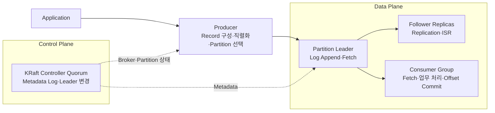

# Kafka 학습 가이드

이 저장소의 Kafka 문서는 한 편에 모든 내용을 넣기보다, **Event가 흐르는 Data Plane**과 **Cluster를 관리하는 Control Plane**을 나누어 읽도록 구성했습니다.

처음부터 모든 설정을 외우기보다 다음 질문에 답할 수 있게 되는 것을 목표로 합니다.

```text
Record는 어디에 저장되는가?
어느 Partition으로 가는가?
누가 읽고 어디까지 읽었는지를 어떻게 기억하는가?
Broker 장애가 나면 어떤 Replica가 이어받는가?
Kafka 내부의 데이터 처리와 Cluster Metadata 관리는 어떻게 나뉘는가?
```

## 전체 구조



## 추천 읽기 순서

### 1. 기본 뼈대

먼저 [Kafka 기본 개념](KAFKA_BASIC_CONCEPTS.md)을 읽습니다.

여기서는 다음 범위만 확실히 잡으면 됩니다.

- Kafka가 해결하려는 문제
- Event·Command·Record
- Topic·Partition·Log·Offset·Segment·Retention
- Producer·Consumer·Consumer Group
- Current Position·Committed Offset·Offset Commit

기본 문서 뒤쪽의 Broker·Replication·ISR 절은 전체 그림을 위한 요약입니다. 상세한 서버 구조는 다음 문서에서 다시 설명하므로 처음에는 핵심 흐름만 확인해도 됩니다.

### 2. Producer 데이터 경로

[Kafka Producer](KAFKA_PRODUCER.md)에서 애플리케이션의 Event가 Kafka Record가 되어 Partition Leader로 가는 과정을 봅니다.

```text
ProducerRecord
→ Serializer
→ Partitioner
→ Partition별 Batch
→ Partition Leader Broker
→ acks 응답
```

그 다음 [Producer 심화](KAFKA_PRODUCER_DEEP_DIVE.md)에서 TCP·Protocol·Retry·Timeout·Buffer·In-flight를 읽습니다.

### 3. Broker와 Cluster

[Kafka Broker와 Cluster 구조](KAFKA_BROKER_AND_CLUSTER.md)에서 Record가 실제로 어디에 저장되는지, Leader·Follower·Replica가 어떤 관계인지 확인합니다.

```text
Topic
└── Partition
    └── Replica
        └── Broker Storage의 Partition Log
```

### 4. 동작 원리와 운영 포인트

[Kafka 딥다이브](KAFKA_DEEP_DIVE.md)에서 Segment·Retention, Consumer Group 내부 동작, Rebalance·Lag, Replication·ISR·ELR, Topic 설계를 이어서 봅니다.

### 5. 전송 보장과 분산 정합성

[전송 보장과 분산 정합성](KAFKA_DELIVERY_GUARANTEES.md)에서 다음 경계를 구분합니다.

| 문제 | 핵심 개념 |
|---|---|
| Kafka 저장 내구성 | `acks`, ISR, `min.insync.replicas` |
| Producer 자동 Retry 중복 | Idempotent Producer |
| Kafka 내부 Input·Output 원자성 | Kafka Transaction·EOS |
| DB 변경과 발행 의도 누락 | Transactional Outbox |
| Consumer 업무 중복 | Inbox·`eventId` 멱등성 |
| 여러 서비스의 업무 흐름 | Saga·보상 Transaction |

### 6. 현재 Control Plane

[KRaft Mode](KAFKA_KRAFT_MODE.md)에서 현재 Kafka의 Controller Node·Controller Quorum·Active Controller·Metadata Log·Broker 등록·장애 흐름을 읽습니다.

### 7. 과거 구조와 호환성 이해

[ZooKeeper Mode](KAFKA_ZOOKEEPER_MODE.md)는 새 시스템을 구성하기 위한 문서가 아니라, 기존 Kafka 3.x 운영 환경과 오래된 문서를 이해하기 위한 참고 문서입니다.

## 목적별 빠른 경로

| 목적 | 읽을 문서 |
|---|---|
| Kafka를 처음 공부 | 기본 개념 → Producer → Broker와 Cluster |
| Producer 개발 | Producer → Producer 심화 → 전송 보장 |
| Consumer 장애·Lag 분석 | 기본 개념의 Offset → 딥다이브의 Consumer Group |
| Broker 운영 | Broker와 Cluster → 딥다이브 → KRaft |
| Kafka 장애·내구성 이해 | Broker와 Cluster → 딥다이브의 Replication → 전송 보장 |
| 기존 ZooKeeper Kafka 이해 | Broker와 Cluster → ZooKeeper Mode → KRaft Mode 비교 |
| Spring Kafka 설정 시작 | Producer → 전송 보장 → [Spring YAML Builder](site/yaml-builder.html) |

## 학습 완료 체크리스트

- [ ] 하나의 Record가 Topic·Partition·Offset으로 어떻게 위치를 갖는지 설명할 수 있다.
- [ ] 같은 Key가 왜 같은 Partition으로 가는지, Partition 수를 늘리면 왜 주의해야 하는지 설명할 수 있다.
- [ ] Producer가 Bootstrap Broker가 아니라 Partition Leader로 요청을 보내는 이유를 설명할 수 있다.
- [ ] 같은 Consumer Group 안에서 Partition과 Consumer가 어떻게 매핑되는지 설명할 수 있다.
- [ ] Current Position과 Committed Offset의 차이를 설명할 수 있다.
- [ ] `poll → 업무 처리 → Offset Commit` 순서가 왜 중요한지 설명할 수 있다.
- [ ] Leader·Follower·ISR·ELR의 차이를 설명할 수 있다.
- [ ] `acks=all`과 `min.insync.replicas`의 역할을 구분할 수 있다.
- [ ] Idempotence·Kafka Transaction·Outbox·Inbox의 보장 범위를 구분할 수 있다.
- [ ] KRaft Controller Quorum과 Partition Replica 복제가 서로 다른 이유를 설명할 수 있다.

## 보조 자료

- [시각적 Kafka 학습 페이지](site/index.html)
- [Spring YAML Builder](site/yaml-builder.html)
- [Kafka Producer 흐름 다이어그램](site/assets/diagrams/producer-flow.svg)
- [Kafka Cluster 개요 다이어그램](site/assets/diagrams/producer-cluster-overview.svg)

