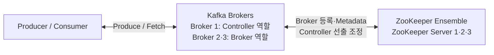

# Apache Kafka ZooKeeper Mode

이 문서는 과거 Kafka가 외부 ZooKeeper Ensemble을 사용해 Cluster Metadata와 Controller 선출을 관리한 구조를 정리합니다.

현재 Apache Kafka 4.x에서는 ZooKeeper Mode가 제거되었습니다. 하지만 기존 Kafka 3.x 기반 시스템과 오래된 운영 문서를 이해하려면 기본 구조를 알아둘 필요가 있습니다.

전체 읽기 순서는 [Kafka 학습 가이드](KAFKA_STUDY_GUIDE.md)를 참고하세요.

먼저 [Broker와 Cluster 기본 구조](KAFKA_BROKER_AND_CLUSTER.md)를 읽으면 Broker, Cluster Metadata, Controller의 관계를 이해하기 쉽습니다.

```text
ZooKeeper Ensemble
→ Broker 등록과 Session
→ Controller Broker 선출
→ Metadata 저장과 전달
→ 장애 처리
```

---

## 1. 과거의 ZooKeeper 방식

ZooKeeper는 분산 시스템의 설정, 등록, 상태 감지, Leader 선출 같은 Coordination을 지원하는 외부 시스템입니다.

과거 Kafka는 Cluster Metadata를 관리하기 위해 별도의 ZooKeeper Ensemble을 함께 운영했습니다. Kafka 3.9가 ZooKeeper Mode를 지원한 마지막 3.x 버전이며, Kafka 4.0부터는 ZooKeeper Mode가 제거되었습니다.

여기서 과거 구조라는 표현은 ZooKeeper Mode Cluster가 현재 모두 사라졌다는 뜻이 아닙니다. 기존 Kafka 3.x 기반 시스템이나 Vendor가 지원하는 구버전 Cluster에는 여전히 남아 있을 수 있습니다. 다만 현재 Apache Kafka 4.x로 새 Cluster를 구성하거나 기존 Cluster를 업그레이드하려면 KRaft를 기준으로 해야 합니다.

### ZooKeeper는 Kafka와 별도의 시스템이다

KRaft와 달리 ZooKeeper Mode에서는 Kafka 외부에 ZooKeeper 서버 프로세스를 별도로 실행해야 했습니다.

```text
Kafka Broker Process들
+
ZooKeeper Server Process들
= ZooKeeper Mode Kafka 운영 환경
```

ZooKeeper 서버가 Producer의 Record를 받거나 Consumer에게 Record를 반환한 것은 아닙니다. Event Data는 과거에도 Kafka Broker의 Partition Log에 저장되었습니다.

### 실행 구성



Kafka Broker Process와 ZooKeeper Server Process는 다음처럼 서로 다른 Host나 VM에 배치할 수 있었습니다.

```text
Host 1, 2, 3    -> ZooKeeper Server Process들
Host 4, 5, 6... -> Kafka Broker Process들
```

### 예전에는 서로 다른 두 Cluster가 붙어 있었다

```text
┌──────────────────────── Kafka Cluster ───────────────────────┐
│  Broker 1       Broker 2       Broker 3                       │
│  Produce·Fetch · Partition Log · Replica 복제                 │
└──────────────────────────────────────────────────────────────┘
                  │ Broker 등록 · 상태 감지
                  │ Controller 선출 · Metadata 조정
                  ▼
┌──────────────────── ZooKeeper Ensemble ──────────────────────┐
│  ZK Server 1    ZK Server 2    ZK Server 3                   │
│  ZNode 상태를 Quorum으로 합의하는 별도의 분산 Cluster          │
└──────────────────────────────────────────────────────────────┘
```

둘 다 여러 Process로 구성되지만 **같은 Cluster는 아닙니다.** Kafka Cluster는 Event Record를 저장하고 Client 요청을 처리하며, ZooKeeper Ensemble은 Kafka 외부에서 Cluster 상태 조정을 지원합니다. 같은 Host에 함께 둘 수는 있었지만 Process·Disk·장애 영역은 별개였습니다.

Broker는 ZooKeeper 주소를 설정해 Ensemble에 연결했습니다.

```properties
broker.id=1
zookeeper.connect=zk-1:2181,zk-2:2181,zk-3:2181
```

여기서 ZooKeeper Ensemble의 Quorum과 KRaft Controller Quorum은 서로 다른 구성입니다.

```text
ZooKeeper Mode
→ 외부 ZooKeeper Ensemble 자체가 합의를 수행

KRaft Mode
→ Kafka Controller Process들이 Metadata Raft 합의를 수행
```

### 핵심 역할

```text
ZooKeeper Ensemble
└── Cluster Metadata와 Broker 등록 상태 관리

Kafka Broker 중 하나
└── Kafka Controller로 선출되어 Metadata 변경 조율

Kafka Brokers
└── Record를 Partition Log에 저장하고 Client 요청 처리
```

ZooKeeper Server가 Kafka Controller 역할을 맡은 것은 아닙니다. ZooKeeper가 Controller 선출을 조정하고 Metadata를 보관했으며, 실제 Kafka Controller는 Broker 중 하나였습니다.

### Kafka Cluster의 처음 실행 순서

ZooKeeper Mode Cluster는 개념적으로 다음 순서로 시작했습니다.

```text
1. ZooKeeper Server들이 실행되어 Ensemble 구성
2. Kafka Broker들이 실행되고 ZooKeeper에 연결
3. 각 Broker가 ZooKeeper에 자신을 등록
4. Broker들이 Kafka Controller 선출에 참여
5. 한 Broker가 Kafka Controller가 됨
6. Controller가 ZooKeeper에서 Cluster Metadata를 읽어 상태 구성
7. Topic·Partition이 존재하면 Partition Leader 상태 관리
```

새 Cluster에 Topic이 없다면 Broker와 Controller만 등록될 뿐, 아직 관리할 Partition Leader는 없습니다.

### Broker 등록과 ZooKeeper Session

Broker는 시작할 때 ZooKeeper의 `/brokers/ids` 아래에 자신의 `broker.id`로 Ephemeral ZNode를 생성했습니다.

```text
/brokers/ids/1
├── Broker ID
├── Host와 Port
└── Listener 정보
```

Ephemeral ZNode는 Broker와 ZooKeeper의 Session이 살아 있는 동안 유지됩니다.

```text
Broker 실행·Session 정상
→ /brokers/ids/1 유지

Broker 종료 또는 Session 만료
→ /brokers/ids/1 제거
→ Kafka Controller가 Broker 이탈 감지
```

이 등록도 Broker Process가 Cluster 구성원으로 들어오는 과정이지, Broker를 Cluster 전체의 Leader로 등록하는 과정은 아닙니다.

### Kafka Controller 선출

ZooKeeper Mode에서는 Kafka Broker 중 하나가 Controller 역할을 함께 맡았습니다. 여러 Broker가 ZooKeeper의 `/controller` Ephemeral ZNode 생성을 시도하고, 생성에 성공한 Broker가 Kafka Controller가 됐습니다.

이 문서에서는 이렇게 **Kafka Controller 역할을 맡은 Broker**를 짧게 `Controller Broker`라고 부릅니다.

```text
Broker 1 ─┐
Broker 2 ─┼─ /controller 생성 경쟁
Broker 3 ─┘
       ↓
Broker 2가 생성 성공
       ↓
Broker 2 = Kafka Controller
```

ZooKeeper Mode에는 KRaft의 Controller Node·Controller Quorum 구성이 없었습니다. 일반 Broker 중 하나가 Controller 역할을 함께 맡았으며, Controller가 중단되면 다른 Broker가 새 Controller로 선출됐습니다.

### ZooKeeper Leader와 Controller Broker는 다르다

ZooKeeper Ensemble도 내부 합의를 위해 ZooKeeper Server 중 하나를 Leader로 선출합니다. 하지만 이 ZooKeeper Leader는 Kafka Controller가 아닙니다.

```text
ZooKeeper Server들
└── ZooKeeper Leader 선출
    └── ZNode 상태의 합의와 복제 주도

Kafka Broker들
└── Controller Broker 선출
    └── Kafka Cluster Metadata 변경 주도
```

즉 ZooKeeper Mode에는 **ZooKeeper 내부 Leader**와 **Kafka Controller Broker**라는 서로 다른 대표 역할이 있었습니다. KRaft에서는 Controller Quorum의 Metadata Log Leader가 곧 Active Controller이므로 이 관계가 Kafka 내부의 한 구조로 통합됩니다.

### Metadata 저장과 변경 전달

ZooKeeper는 Broker 등록, Topic, Partition, Replica 배치, Partition Leader와 ISR 같은 Cluster Metadata를 ZNode 구조에 보관했습니다.

```text
ZooKeeper ZNode
├── /brokers/ids/...
├── /brokers/topics/...
├── /controller
└── Partition 상태와 각종 Cluster 설정
```

Kafka Controller는 ZooKeeper의 변화를 Watch하고, Cluster 상태 변경을 결정한 뒤 다른 Broker에 Controller RPC를 보냈습니다.

```text
Topic 생성 또는 Broker 장애
→ ZooKeeper Metadata 변경
→ Kafka Controller가 변경 감지·처리
→ Partition Leader와 Replica 상태 결정
→ Controller가 Broker들에 LeaderAndIsr·UpdateMetadata RPC 전송
→ Broker들이 로컬 상태 반영
```

KRaft에서 Broker가 Commit된 Metadata 변경분을 Fetch하는 것과 달리, ZooKeeper Mode에서는 Kafka Controller가 Broker에 Metadata 관련 RPC를 보내는 경로가 중심이었습니다.

### Broker와 Controller 장애

Broker 장애는 ZooKeeper Session과 Ephemeral ZNode를 이용해 감지했습니다.

```text
Broker 장애
→ ZooKeeper Session과 등록 정보 변화
→ Kafka Controller가 변화 감지
→ 새 Partition Leader 결정
→ 다른 Broker에 LeaderAndIsr·UpdateMetadata 전달
```

Controller Broker가 장애 나면 `/controller` Ephemeral ZNode가 사라지고 다른 Broker들이 Controller 선출에 다시 참여했습니다.

```text
Kafka Controller 장애
→ /controller ZNode 제거
→ 다른 Broker들이 /controller 생성 경쟁
→ 새 Kafka Controller 선출
→ 새 Controller가 ZooKeeper에서 Metadata를 읽어 상태 구성
```

### ZooKeeper가 복잡도를 만든 지점

Kafka 운영자는 두 종류의 분산 시스템을 함께 운영해야 했습니다.

```text
Kafka Cluster
+
ZooKeeper Ensemble
```

또한 Metadata의 저장은 ZooKeeper가 담당하고 변경 처리는 Kafka Controller가 담당했기 때문에, Metadata 변경과 전달 경로가 두 시스템에 걸쳐 있었습니다. Controller가 교체될 때는 새 Controller가 ZooKeeper에서 Cluster Metadata를 다시 읽어 상태를 구성해야 했습니다.

이 구조는 오랫동안 Kafka를 안정적으로 운영하게 해줬지만, Cluster 규모가 커질수록 Metadata 확장과 운영 복잡도를 줄이기 위한 Kafka 자체 Metadata 관리 구조가 필요해졌습니다.

---

## 2. 핵심 정리

```text
ZooKeeper Ensemble
= Kafka 외부에서 Cluster Metadata와 Broker 등록 상태 관리

Controller Broker
= ZooKeeper Mode에서 Kafka Controller 역할을 맡은 Broker

ZooKeeper Leader
= ZooKeeper Ensemble 내부의 합의와 ZNode 복제를 주도
= Kafka Controller와는 다른 역할

Event Record
= ZooKeeper가 아니라 Kafka Broker의 Partition Log에 저장
```

ZooKeeper Mode에서는 Metadata 저장과 Coordination은 ZooKeeper가, Kafka Metadata 변경 처리는 Controller Broker가 담당했습니다.

---

## 3. 학습 체크포인트

- ZooKeeper는 Kafka Cluster 외부에서 어떤 역할을 했는가?
- Broker는 ZooKeeper에 자신을 어떻게 등록했는가?
- Ephemeral ZNode와 Session은 Broker 장애 감지에 어떻게 사용됐는가?
- Controller Broker는 어떻게 선출됐는가?
- ZooKeeper Leader와 Controller Broker는 무엇이 다른가?
- Controller Broker 장애 시 어떤 순서로 새 Controller가 선출되는가?
- Event Record는 왜 ZooKeeper에 저장되지 않는가?

---

## 4. 다음 글

- [KRaft Mode - 현재의 Kafka Control Plane](KAFKA_KRAFT_MODE.md)

---

## 5. 공식 문서

- [Apache Kafka 3.9 ZooKeeper](https://kafka.apache.org/39/operations/zookeeper/)
- [Apache Kafka 3.9 ZooKeeper Broker 등록 구조](https://kafka.apache.org/39/implementation/distribution/)
- [Apache Kafka 4.0 릴리스 안내](https://kafka.apache.org/blog/2025/03/18/apache-kafka-4.0.0-release-announcement/)
- [KIP-500: ZooKeeper를 자체 Metadata Quorum으로 대체](https://cwiki.apache.org/confluence/display/kafka/kip-500%3A%2Breplace%2Bzookeeper%2Bwith%2Ba%2Bself-managed%2Bmetadata%2Bquorum)
